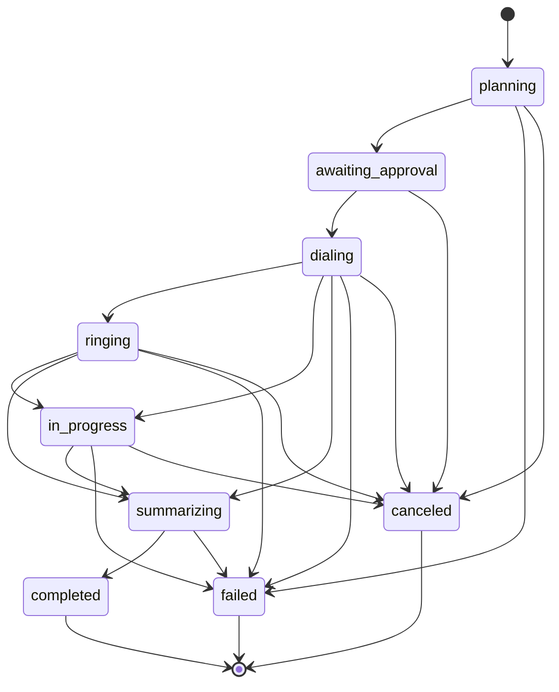

# 콜비 — 데이터 흐름

모든 상태 변경은 `CallService`의 두 private 메서드를 지난다. `transition(task, to)`는 `assertTransition`으로 전이를 검사한 뒤 `persist`를 부르고, `persist(task)`는 `version += 1`, `updatedAt` 갱신, `store.save(task)`, `bus.publish({ type: "task.updated", task })`를 차례로 한다. 따라서 아래 흐름에서 「저장」이라고 적은 곳마다 버전이 오르고 스트림 이벤트가 하나 나간다.

## 작업 상태 전이 (`server/src/domain/stateMachine.ts`)

`awaiting_approval → failed`는 없다. 재시작 복구(`recoverInterruptedTasks`)는 `transition`을 거치지 않고 상태를 직접 `failed`로 바꾼다.

## 1. 작업 생성

1. 앱: `NewCallScreen` → `CallsController.create(NewCallRequest)` → `CallsRepository.create` → `POST /v1/tasks`.
2. 서버: 스키마 검증(`http/app.ts`) → `CallService.create`. 검사 순서는 503 `shutting_down` → 400 번호(`checkTargetNumber`: `invalid_phone` / `blocked_number`) → 429 상한(`services/callService.ts`). 발신 직전에도 저장된 번호를 다시 검사한다.
3. `create`는 `status: "planning"`, `version: 0`, 빈 대화록·승인 목록, `provider: this.provider.name`으로 작업을 만들어 저장한다(버전 1). 이어서 `plan()`을 기다리지 않고 실행한 뒤 바로 반환하므로 HTTP 응답은 201과 `planning` 상태다.
4. `plan()`: `brain.createPlan(input)`이 끝나면, 작업이 여전히 `planning`일 때만 `plan`을 채우고 `awaiting_approval`로 전이한다. 실패하면 `error`를 적고 `failed`로 간다. 그사이 취소되었으면 결과를 버린다.
5. 앱은 계획 완료를 HTTP가 아니라 `/v1/stream`의 `task.updated`로 받는다.

## 2. 계획 승인과 발신

1. 앱: `CallsController.approvePlan(id, openingLine?)` → `POST /v1/tasks/:id/approve-plan`. 앱은 수정한 첫 인사말만 `{ plan: { openingLine } }`으로 보낸다. 서버 스키마는 그 밖의 `plan` 필드도 받는다.
2. `approvePlan`: `awaiting_approval`이 아니거나 계획이 없으면 409 `invalid_state`. 다음으로 `assertWithinLimits()` — 진행 중 통화 수가 `maxConcurrentCalls` 이상이면 429 `too_many_active_calls`, 최근 24시간 안에 `startedAt`이 있는 작업 수가 `maxCallsPerDay` 이상이면 429 `daily_limit`. 상한 검사는 생성 시점이 아니라 이 시점에 한다.
3. 계획을 병합하고 `startedAt`을 기록한 뒤 `dialing`으로 전이한다.
4. `openSession(taskId)`가 `AbortController`와 최대 통화 시간 타이머(`maxCallDurationMs`, 만료 시 `hangup` 후 종료)를 만들고 `CallSession`을 돌려준다.
5. `provider.start(session)`. 예외가 나면 `session.end({ error })`로 바로 요약 단계로 넘긴다.
   - 시뮬레이션: 템플릿을 재생하며 `markRinging` → `markConnected` → `appendTranscript` → (승인 단계) `requestApproval` → `end()`.
   - KAT: `POST /group/{groupId}/media-stream/calls`(`Idempotency-Key: taskId`, `streamUrl`, `statusCallbackUrl`, `metadata.taskId`·`token`)로 발신만 요청하고 반환한다. 이후 상태 웹훅과 미디어 스트림이 세션 메서드를 호출한다(`entry-points.md` 「웹훅 처리」).

## 3. 통화 중

- `markRinging`, `markConnected`, `appendTranscript`는 작업이 진행 중 상태(`dialing`/`ringing`/`in_progress`)일 때만 반영된다. `markConnected`는 `connectedAt`을 적는다.
- 대화록 항목은 하나 추가될 때마다 저장되므로, 발화마다 `task.updated`가 나간다.

## 4. 통화 중 승인(코멘트 포함)

1. 제공자가 `session.requestApproval(question)`을 부른다. KAT 경로에서는 OpenAI Realtime이 `request_user_approval` 도구를 호출할 때다(`realtimeBridge.ts`).
2. `CallService.requestApproval`: 작업이 진행 중이 아니거나 세션이 이미 중단됐으면 바로 `{ approved: false, reason: "canceled" }`. 그렇지 않으면 `ApprovalRequest`(`pending`, `expiresAt = now + approvalTimeoutMs`)를 추가해 저장하고, `pendingApprovals`에 resolver와 타이머를 둔 Promise를 반환한다.
3. 앱: `pendingApprovalsProvider`가 대기 중인 승인을 모으고, `ApprovalListener`가 알림을, `ApprovalCard`가 응답 UI를 띄운다. 응답은 `CallsController.decide` → `POST /v1/tasks/:id/approvals/:approvalId` `{ decision: "approve" | "reject", comment? }`. 앱은 코멘트를 다듬어 비어 있으면 보내지 않는다. 서버 스키마의 코멘트 한도는 500자다(`tech.md`).
4. `respondToApproval`: 승인 레코드와 `pendingApprovals` 항목이 모두 있고 `pending`일 때만 처리하며, 아니면 409 `approval_closed`. `resolveApproval`이 타이머를 지우고 `status`·`resolvedAt`·`userComment`를 적어 저장한 뒤 Promise를 `{ approved, comment, reason }`으로 푼다.
5. 제한 시간이 지나면 `expired`/`expired`, 세션이 중단되면 `expired`/`canceled`로 같은 경로를 탄다.
6. KAT 경로에서는 결과가 도구 응답 `{ approved, reason, user_comment, instruction }`으로 Realtime 모델에 돌아간다. `instruction`은 코멘트를 조건으로 따르되 안전·결제·개인정보 정책을 넘지 말라는 지시를 붙인다(`approvalToolInstruction`).

## 5. 종료와 요약

1. `session.end(options)` → `endSession`: 중복 호출을 막고, 타이머를 지우고, `AbortController.abort()`(대기 중인 승인도 `canceled`로 풀림)를 한 뒤, 작업이 진행 중이면 `endedAt`과 `error`를 적고 `summarizing`으로 전이한다.
2. `summarize`: 상대나 에이전트의 발화가 하나도 없고 오류도 없으면, 연결 여부에 따라 오류 문구를 채운다. `brain.summarize(task)`로 `outcome`을 만들고(실패 시 오류만 남김), 「오류가 있고 발화가 없으면」 `failed`, 그 밖에는 `completed`로 전이한다. 발화가 있었다면 오류가 있어도 `completed`다.

## 6. 취소와 삭제

- `cancel`: 종료 상태나 `summarizing`이면 그대로 반환한다. 진행 중이면 `provider.hangup()` 후, `in_progress`였으면 `endSession`으로 요약까지 진행하고 아니면 `canceled`로 끝낸다. `planning`·`awaiting_approval`은 바로 `canceled`.
- `delete`: 종료 상태나 `awaiting_approval`일 때만 허용(아니면 409). 저장소에서 지우고 `task.deleted`를 발행한다. 이 경로는 `persist`를 거치지 않는다.

## 클라이언트 병합 규칙 (`app/lib/features/calls/application/calls_controller.dart`)

`CallsController` 상태는 `Map<String, CallTask>`다.

| 입력 | 처리 |
|---|---|
| 첫 로드 | `/v1/stream` 채널을 열고 `connect()`한 뒤 `GET /v1/tasks` 결과를 `_merge` |
| `snapshot`(WS) 또는 `refresh()` | `_merge`: 스냅샷에 있는 작업만 남기고, 각 작업은 기존 것과 비교해 버전이 큰 쪽 |
| `task.updated`(WS) | 해당 작업만 `_newer`로 교체 |
| HTTP 응답(`create`, `approvePlan`, `cancel`, `decide`) | `_upsert` → `task.updated`와 같은 경로 |
| `task.deleted`(WS) 또는 `delete()` | 맵에서 제거 |

`_newer`는 기존 버전이 **더 클 때만** 기존 것을 남기므로, 버전이 같으면 새로 들어온 것으로 바꾼다. 상태가 아직 없을 때(`current == null`) 도착한 `task.updated`·`task.deleted`는 버려지며, 이어지는 HTTP 목록이나 다음 스냅샷이 메운다. 연결이 끊기면 `LiveChannel`이 최대 30초 간격으로 재연결하고, 서버가 재연결마다 스냅샷을 다시 보내므로 놓친 이벤트가 복구된다.

## JSON 파일 저장 (`server/src/store/taskStore.ts`)

- 경로: `DATA_FILE`(기본 `data/tasks.json`, 작업 디렉터리 기준 상대 경로).
- 형식: `list()` 결과(생성 시각 내림차순) 배열을 들여쓰기 2칸 JSON으로 쓴다. 대화록·승인·결과를 포함한 작업 전체가 들어간다.
- 쓰는 시점: `save` 또는 성공한 `delete`가 300ms 타이머를 건다. 타이머가 이미 있으면 새로 걸지 않으므로, 300ms 안의 변경은 한 번에 기록된다. `flush`는 디렉터리를 만들고 `<path>.tmp`에 쓴 뒤 `rename`으로 바꿔치기하며, 쓰기 작업은 Promise 체인으로 직렬화된다.
- 종료 시 `index.ts`가 `flush()`를 직접 불러 대기 중인 변경을 기록한다. 강제 종료되면 마지막 300ms 안의 변경은 잃을 수 있다.

## 재시작 복구 (`CallService.recoverInterruptedTasks`)

기동 시 한 번, 저장소의 모든 작업을 훑는다.

- 종료 상태와 `awaiting_approval`은 그대로 둔다. 승인 대기 작업은 재시작 뒤에도 승인해 발신할 수 있다.
- 나머지(`planning`, `dialing`, `ringing`, `in_progress`, `summarizing`)는 `failed`로 바꾸고 `"서버가 재시작되어 작업이 중단되었습니다."`를 적으며, `endedAt`이 없으면 채우고, `pending` 승인은 `expired`로 바꾼 뒤 저장한다.
- 메모리에만 있던 세션·승인 Promise·KAT 통화 매핑은 복구하지 않는다. KAT 쪽 실제 통화가 재시작 후 어떻게 끝나는지는 미확인이다.

---

Generated by /moai project on 2026-11-20; based on repository state at commit c95953f.
