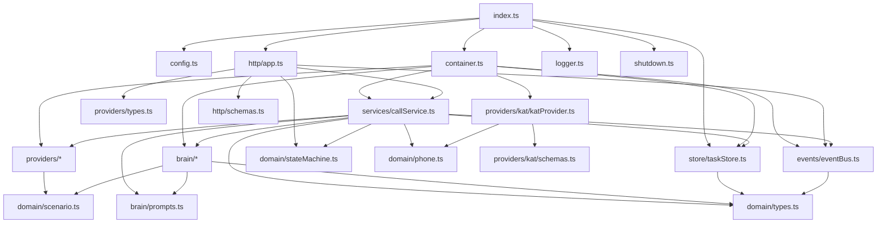
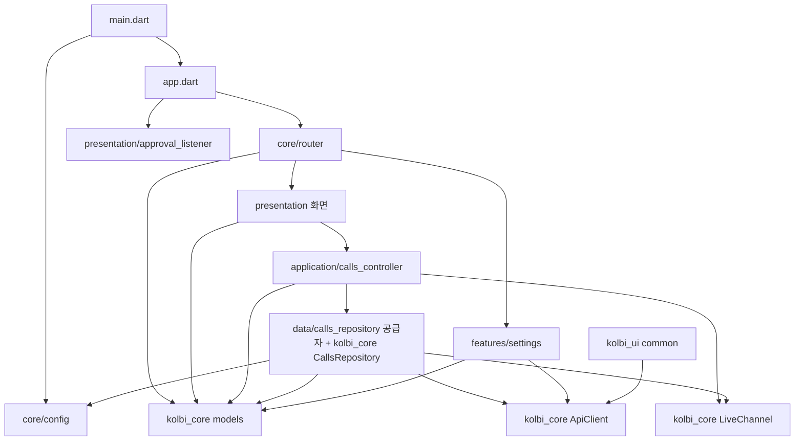

# 콜비 — 의존성

## 외부 패키지

버전과 용도 표는 `tech.md` 「기술 스택」에 있다(`server/package.json`, `app/pubspec.yaml`과 대조해 일치함을 확인했다). 여기서는 각 패키지를 실제로 가져다 쓰는 파일만 덧붙인다.

### 서버

| 패키지 | 사용 파일 |
|---|---|
| `fastify` ^5.12.8 | `http/app.ts` |
| `@fastify/cors` ^11.4.3 | `http/app.ts` (`CORS_ORIGINS`가 있을 때만 등록) |
| `@fastify/formbody` ^9.0.2 | `http/app.ts` |
| `@fastify/websocket` ^11.3.7 | `http/app.ts` (`/v1/stream`, `/kat/media`, `maxPayload` 1MiB) |
| `ws` ^8.23.0 | `providers/realtimeBridge.ts`(OpenAI Realtime 클라이언트), `providers/kat/katProvider.ts`(타입) |
| `zod` ^4.6.7 | `config.ts`, `http/schemas.ts`, `http/app.ts`(`ZodError`), `brain/openaiBrain.ts` |
| Node 내장 | `node:crypto`(UUID, HMAC, `timingSafeEqual`), `node:fs/promises`, `node:events`, `node:stream`, `node:timers/promises` |

OpenAI와 KAT Cloud는 SDK 없이 전역 `fetch`와 `ws`로 호출한다(`openaiBrain.ts`, `katProvider.ts`).

### 앱

| 패키지 | 사용 파일 |
|---|---|
| `flutter_riverpod` ^3.5.0 | `main.dart`, `app.dart`, `core/config`, `core/router`, `features/**` |
| `go_router` ^18.1.4 | `core/router/app_router.dart`, 화면의 내비게이션 |
| `http` ^1.6.0 | `packages/kolbi_core/lib/src/network/api_client.dart` (앱 `core/network/api_client.dart`는 다시 내보내기) |
| `web_socket_channel` ^3.0.3 | `packages/kolbi_core/lib/src/network/live_channel.dart` (앱 `core/network/live_channel.dart`는 다시 내보내기) |
| `shared_preferences` ^2.5.6 | `main.dart`, `core/config/app_settings.dart` |
| `intl` ^0.20.3 | `main.dart`(`initializeDateFormatting('ko')`), 형식 처리 |
| `material_ui` ^1.1.0 | 위젯 전반(`package:material_ui/material_ui.dart`), `packages/kolbi_ui` |

### 공용 패키지 (SPEC-MODULE-001, 루트 `pubspec.yaml` 워크스페이스)

| 패키지 | 의존(`pubspec.yaml`) |
|---|---|
| `kolbi_core` | `characters` ^1.4.1, `http` ^1.6.0, `intl` ^0.20.3, `meta` ^1.19.0, `web_socket_channel` ^3.0.3; dev `test` ^1.29.0 |
| `kolbi_ui` | `flutter`, `kolbi_core` ^0.1.0, `material_ui` ^1.1.0; dev `flutter_test` |
| `app` | 위 표 + `kolbi_core` ^0.1.0, `kolbi_ui` ^0.1.0 |
| 루트(`kolbi_workspace`) | dev `test` ^1.29.0 (`test/workspace_test.dart`) |

## 내부 의존 그래프

### 서버 (import 문 기준, 타입 전용 import 포함)

계층을 벗어나는 지점:

SPEC-POLICY-001과 SPEC-ARCH-001로 해소된 이전 예외(참고용): 번호 정책은 이제 `CallService`가 강제하고 `http/app.ts`는 `domain/phone.ts`를 import하지 않는다. `http/app.ts`는 `KatCallProvider`를 모르며 제공자가 선언한 `ProviderRoutes`만 등록한다. `providers/`는 `brain/`을 import하지 않는다(시나리오는 `domain/scenario.ts`, 에이전트 지시문은 `CallService`가 `buildAgentInstructions`로 만들어 `CallSession`에 담아 전달). 세 규칙은 `architecture.test.ts`가 검사한다.

남은 예외:
- `CallService`는 `CallBrain`·`CallProvider`·`TaskStore`는 인터페이스로 받지만, `EventBus`는 구체 클래스를 타입으로 받는다.

### 앱 (상대 경로 import 기준)

`structure.md`가 적은 대로 주 흐름은 `presentation → application → data → domain`이다. SPEC-MODULE-001 이후 앱 소스는 모델·네트워크·테마·공용 위젯을 `kolbi_core`·`kolbi_ui` 배럴로 가져온다(그래프의 패키지 노드). 예외는 다음과 같다.

- `presentation/home_screen.dart`가 `data/calls_repository.dart`를 직접 import한다(`LiveChannel`은 `kolbi_core` 배럴로).
- `core/router/app_router.dart`가 `features/` 화면을 import한다(모델은 `kolbi_core` 배럴로). 공통 계층인 `core`가 기능 계층에 의존하는 역방향이다.
- `packages/kolbi_ui/lib/src/widgets/common.dart`가 `kolbi_core` 배럴을 import한다(오류가 `ApiException`이면 `userMessage`를 보여 주기 위해서다, `common.dart:269`). 허용된 방향(`kolbi_ui → kolbi_core`)이다.
- `features/settings/settings_screen.dart`가 `calls` 기능의 `presentation/trust_notice.dart`를 가져온다(`settings_screen.dart:8`). 남은 기능 간 의존 1건이며 `app/test/architecture_test.dart` 허용 목록에 있다. 분리 전의 다른 1건(`call_models.dart`)은 `kolbi_core` 배럴 import로 풀렸다.

---

Generated by /moai project on 2026-11-20; based on repository state at commit c95953f. Updated by /moai sync on 2026-11-27 for SPEC-MODULE-001 (state at 6cdf8af).
