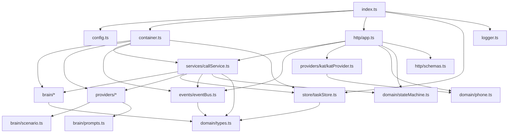
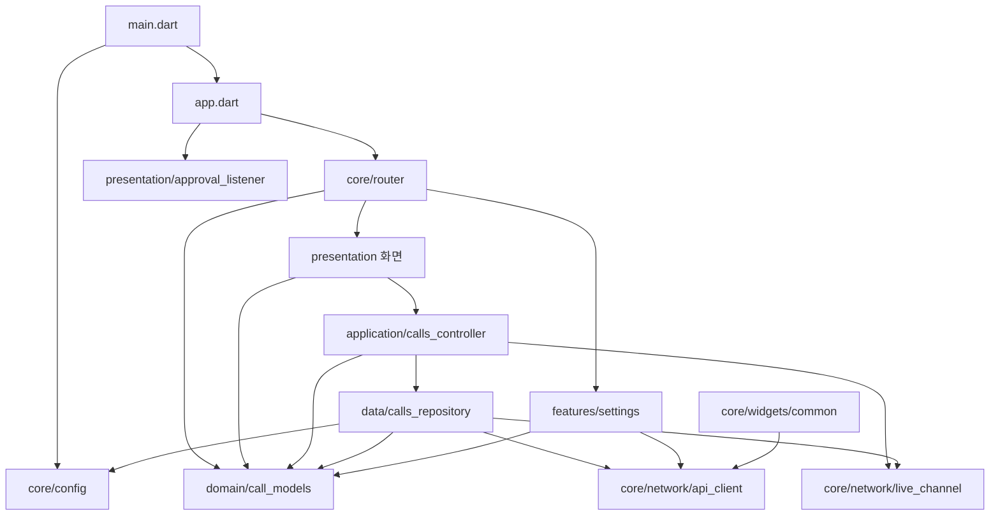

# 콜비 — 의존성

## 외부 패키지

버전과 용도 표는 `tech.md` 「기술 스택」에 있다(`server/package.json`, `app/pubspec.yaml`과 대조해 일치함을 확인했다). 여기서는 각 패키지를 실제로 가져다 쓰는 파일만 덧붙인다.

### 서버

| 패키지 | 사용 파일 |
|---|---|
| `fastify` ^5.12.8 | `http/app.ts` |
| `@fastify/cors` ^11.4.3 | `http/app.ts` (`CORS_ORIGINS`가 있을 때만 등록) |
| `@fastify/formbody` ^9.0.2 | `http/app.ts` |
| `@fastify/websocket` ^11.3.7 | `http/app.ts` (`/v1/stream`, `/kat/media`, `maxPayload` 1MiB) |
| `ws` ^8.23.0 | `providers/realtimeBridge.ts`(OpenAI Realtime 클라이언트), `providers/kat/katProvider.ts`(타입) |
| `zod` ^4.6.7 | `config.ts`, `http/schemas.ts`, `http/app.ts`(`ZodError`), `brain/openaiBrain.ts` |
| Node 내장 | `node:crypto`(UUID, HMAC, `timingSafeEqual`), `node:fs/promises`, `node:events`, `node:stream`, `node:timers/promises` |

OpenAI와 KAT Cloud는 SDK 없이 전역 `fetch`와 `ws`로 호출한다(`openaiBrain.ts`, `katProvider.ts`).

### 앱

| 패키지 | 사용 파일 |
|---|---|
| `flutter_riverpod` ^3.5.0 | `main.dart`, `app.dart`, `core/config`, `core/router`, `features/**` |
| `go_router` ^18.1.4 | `core/router/app_router.dart`, 화면의 내비게이션 |
| `http` ^1.6.0 | `core/network/api_client.dart` |
| `web_socket_channel` ^3.0.3 | `core/network/live_channel.dart` |
| `shared_preferences` ^2.5.6 | `main.dart`, `core/config/app_settings.dart` |
| `intl` ^0.20.3 | `main.dart`(`initializeDateFormatting('ko')`), 형식 처리 |
| `material_ui` ^1.1.0 | 위젯 전반(`package:material_ui/material_ui.dart`) |

## 내부 의존 그래프

### 서버 (import 문 기준, 타입 전용 import 포함)

계층을 벗어나는 지점:

- `http/app.ts`가 `services`를 거치지 않고 `domain/phone.ts`를 직접 써서 번호를 정규화·차단한다. 작업 생성 입력 검증의 일부가 서비스가 아니라 HTTP 계층에 있다.
- `http/app.ts`가 구체 클래스 `KatCallProvider`를 타입으로 import하고, KAT 라우트에서 그 메서드를 직접 호출한다. `CallProvider` 인터페이스를 우회하는 유일한 경로다.
- `providers/`가 `brain/`의 `scenario.ts`(`simulatedProvider.ts`)와 `prompts.ts`(`realtimeBridge.ts`)를 가져온다. 두 모듈은 형제 관계지만 이 방향으로만 의존한다.
- `CallService`는 `CallBrain`·`CallProvider`·`TaskStore`는 인터페이스로 받지만, `EventBus`는 구체 클래스를 타입으로 받는다.

### 앱 (상대 경로 import 기준)

`structure.md`가 적은 대로 주 흐름은 `presentation → application → data → domain`이다. 예외는 다음과 같다.

- `presentation/home_screen.dart`가 `data/calls_repository.dart`와 `core/network/live_channel.dart`를 직접 import한다.
- `core/router/app_router.dart`가 `features/` 화면과 `call_models.dart`를 import한다. 공통 계층인 `core`가 기능 계층에 의존하는 역방향이다.
- `core/widgets/common.dart`가 `core/network/api_client.dart`를 import한다(오류가 `ApiException`이면 `userMessage`를 보여 주기 위해서다, `common.dart:193`).
- `features/settings/settings_screen.dart`가 `calls` 기능의 `call_models.dart`와 `core/network/api_client.dart`를 직접 쓴다. 기능 간 의존이다.

---

Generated by /moai project on 2026-11-20; based on repository state at commit c95953f.
