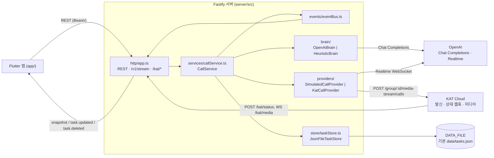

# 콜비 — 아키텍처 개요

콜비(Kolbi, 구 CallMate)의 코드 수준 아키텍처를 정리한다. 제품 이름은 문서에서만 콜비로 바뀌었고, 코드 식별자·패키지·경로는 여전히 `callmate`를 쓴다(`callmate-server`, `CallMateApp`, `CALLMATE_SERVER_URL` 등).

제품 설명은 `product.md`, 디렉터리 배치와 API 표는 `structure.md`, 패키지·환경 변수 표는 `tech.md`에 있다. 이 문서는 그 표를 반복하지 않고 코드에서 확인한 구조만 덧붙인다.

## 시스템 구성도

KAT 관련 경로는 `config.provider === "kat"`일 때만 존재한다. 기본 설정에서는 `SimulatedCallProvider`가 통화를 흉내 내며 외부로 나가는 호출이 없다(두뇌가 `OpenAiBrain`이면 Chat Completions 호출만 생긴다).

## 코드에 실제로 있는 설계 패턴

| 패턴 | 위치 | 내용 |
|---|---|---|
| 인터페이스 기반 구현 선택 | `container.ts` `createContainer` | `CallBrain`, `CallProvider`, `TaskStore` 인터페이스에 맞는 구체 클래스를 설정으로 골라 `CallService` 생성자에 넣는다. 저장소만은 `index.ts`가 `JsonFileTaskStore.open()`으로 만들어 넘긴다 |
| 상태 기계 | `domain/stateMachine.ts` | `TRANSITIONS` 표와 `assertTransition`. `CallService.transition()`이 모든 상태 변경 전에 호출하며, 위반 시 `InvalidTransitionError` → HTTP 409 |
| 이벤트 버스 | `events/eventBus.ts` | Node `EventEmitter` 래퍼. `CallService.persist()`가 변경마다 작업 전체를 `task.updated`로 발행하고, `/v1/stream` 소켓마다 구독한다 |
| 전체 스냅샷 + 버전 | `CallTask.version`, `persist()` | 차분이 아니라 작업 전체를 보낸다. 변경마다 `version`이 1 증가한다 |
| 클라이언트 버전 병합 | `app/.../calls_controller.dart` `_newer`, `_merge` | 같은 작업은 버전이 큰 쪽을 남긴다. 자세한 규칙은 `data-flow.md` |
| 세션 객체(포트) | `providers/types.ts` `CallSession` | 제공자는 오디오·발신만 맡고, 상태·저장·승인·요약은 `CallService`가 세션 메서드를 통해 처리한다 |
| 디바운스 원자적 저장 | `store/taskStore.ts` | 300ms 디바운스 후 임시 파일에 쓰고 `rename` |

## 시스템 경계

- 서버 바깥과의 경계는 세 곳이다. 앱과의 REST·WebSocket(`http/app.ts`), OpenAI(`brain/openaiBrain.ts`, `providers/realtimeBridge.ts`), KAT Cloud(`providers/kat/`).
- 인증은 `/v1/` 경로에만 적용되는 공유 Bearer 토큰(`API_TOKEN`) 하나다. `/health`와 `/kat/*`는 이 검사를 받지 않으며, `/kat/status`와 `/kat/media`는 KAT 서명으로 따로 검증한다.
- 영속 상태는 서버 프로세스 메모리와 JSON 파일 하나뿐이다. 진행 중인 승인 대기(`pendingApprovals`)와 통화 세션(`sessions`)은 메모리에만 있어 재시작하면 사라진다(`data-flow.md` 「재시작 복구」).
- 앱은 상태를 서버에서 받아 보여 주기만 하며, 로컬에 저장하는 것은 설정(`shared_preferences`)뿐이다.

## 목표 방향 (미구현)

허브 플랫폼, 기업 인바운드 에이전트, SDK·애드온 배포, 그리고 A2A·MCP·OAuth·JWT·Ory Hydra는 이 저장소에 존재하지 않는다. 이 codemaps 문서는 그것들을 어떤 모듈에도 대응시키지 않는다. 소유자가 밝힌 방향은 `product.md`와 `tech.md`의 「목표 방향」 절을 참고한다.

---

Generated by /moai project on 2026-11-20; based on repository state at commit c95953f.
