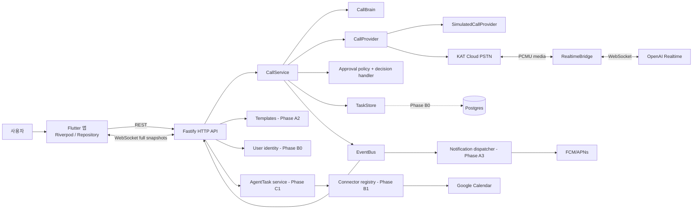
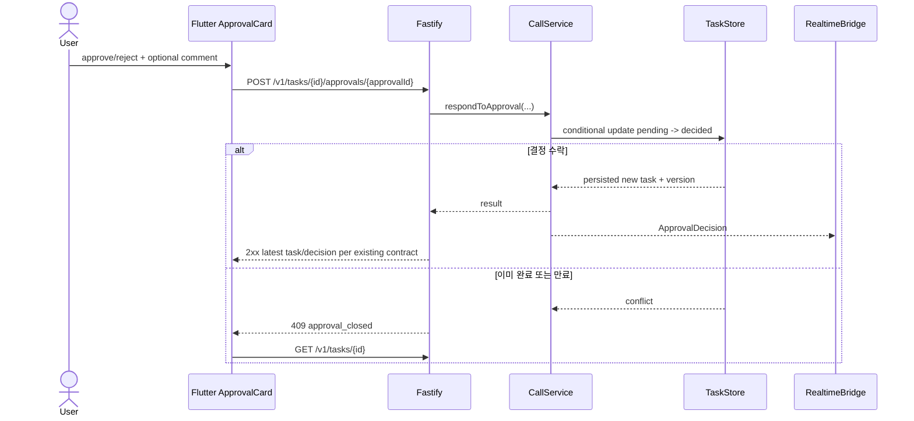

# CallMate 목표 아키텍처 설계서 v1.0

> 원칙: 현재 `ARCHITECTURE.md` 기술을 **기존 구현 기준선**으로 인정한다. 다음 다이어그램/계약 중 신규 항목은 제안이며, 코드베이스 검증 전까지 구현 확정사항이 아니다.

## 1. 시스템 문맥 및 계층



### 설계 경계
- `app/lib/features/calls`: 기존 통화 UX/API 모델 유지.
- `server/src/services/callService.ts`: 현행 통화 상태 머신과 생명주기 유지. 승인 구현은 단순 오케스트레이션으로 위임할 수 있으나 대규모 재작성 금지.
- `server/src/providers`: 전화 공급자 추상화 유지. RealtimeBridge는 음성 프레임과 도구 호출의 어댑터이며 **권한 결정자가 아님**.
- `server/src/events/eventBus.ts`: 승인 상태 변경/알림 이벤트 발행; 중복 상태 전이 방지의 진실 공급원은 스토어/서비스.
- Phase B 이후 `IdentityService`, `ConnectorService`, `AgentTaskService` 등 확장하고 DI 조립은 `container.ts`에서.

## 2. Phase A 모듈 제안

```text
server/src/
  domain/
    types.ts                        # 기존 타입 확장
    stateMachine.ts                 # 기존 상태 전이 유지
    approvalPolicy.ts               # [new] 승인 대상/결정 검증, 금지 동작
  services/
    callService.ts                  # 기존 orchestration 확장
    approvalDecisionService.ts      # [optional new] 결정을 원자 처리
    templatesService.ts             # [A2] 필요 시
  providers/
    types.ts                        # CallSession 결과 계약 수정
    simulatedProvider.ts            # 동일 동작 보장
    realtimeBridge.ts               # 결정 결과를 tool 응답으로 직렬화
  notifications/                    # [A3] 외부 알림 어댑터
  http/                             # 기존 라우팅 패턴 따름
  store/taskStore.ts                # 기존 JSON 스토어 계약과 마이그레이션
app/lib/features/
  calls/domain/                     # ApprovalRequest 파싱/기록
  calls/data/                       # comment 지원 API
  calls/application/                # version 기반 병합 유지
  calls/presentation/               # ApprovalCard/결과 기록
  templates/                        # [A2] UI+local data
  notifications/                    # [A3] permission + deep links
  contacts/                         # [A4] device picker only
  voice_input/                      # [A4] STT
```

**주의:** 위 경로는 목표 설계이며 실제 패키지 구조 확인 뒤 적응. 레포에 없는 패키지나 타입을 임의로 가정해 import하지 않는다.

## 3. 승인 도메인 계약

기존 계약: `POST /v1/tasks/:id/approvals/:approvalId`의 `decision`은 `approve|reject`. 요청에 선택적 `comment`를 추가해 하위 호환한다.

### API 요청 예시

```http
POST /v1/tasks/task_123/approvals/appr_456
Authorization: Bearer <API_TOKEN>
Content-Type: application/json

{"decision":"approve","comment":"예약금은 3만 원까지. 카드 정보 제공 불가."}
```

- `comment`는 **선택**이며 최대 500 Unicode code points 또는 프로젝트 기존 규칙과 정합되는 명시적 기준으로 제한한다. 입력에서 앞뒤 공백을 정리한다.
- 승인 결과는 서버 도메인 상태에 기록한다. 앱 요청 본문에 `approved` 같은 별도 boolean을 중복 수용하지 않는다.
- `approvalId`와 `taskId`가 일치하고 승인 `pending` 상태이며 현재 서버 시간이 `expiresAt` 이전일 때만 결정을 받아들인다.
- 만료/취소/이미 결정은 **409 `approval_closed`**. 서버 측 경합을 직렬화/잠금/compare-and-set으로 보호한다.
- 요청 실패/네트워크 재전송 시 같은 결정의 응답 정책은 실제 API 호환성에 맞춰 정한다. 최소한 **도구 실행은 한 번만** 이루어져야 한다.
- 댓글 텍스트는 사용자 입력이므로 prompt injection, 개인정보, 금지된 동작과 충돌할 수 있다. 모델에 전달할 때 사용자 코멘트로 경계를 표시하고 서버 도메인 정책보다 높은 권한을 부여하지 않는다.

### 서버 내부 타입 (예시)

```ts
type ApprovalDecision = {
  approved: boolean;
  comment?: string;
  reason?: 'user_approved' | 'user_rejected' | 'expired' | 'canceled';
};

type ApprovalStatus = 'pending' | 'approved' | 'rejected' | 'expired' | 'canceled';

// 기존 ApprovalRequest 필드 보존 + 아래 필드만 선택적으로 추가
interface ApprovalRequestExtension {
  userComment?: string;
  decidedAt?: string;
  // status/expiration은 실제 기존 타입 확인 후 통합
}
```

### Realtime 결과 (예시)

```json
{
  "approved": true,
  "user_comment": "예약금은 3만 원까지. 카드 정보 제공 불가.",
  "instruction": "사용자 승인 범위 내에서만 진행하며 카드 정보는 요구하거나 제공하지 않는다."
}
```

**중요:** 이 JSON은 통화 AI에 의사결정 결과를 알려주는 정보이지 결제 API 접근 권한 그 자체가 아니다. 실제 전화 상대방에게 AI가 무단 약정/결제를 확정하지 않도록 단계별 검증과 리스크 분류가 필요하다.

## 4. 승인 시퀀스 및 경합



동시 이벤트 규칙:
1. 종료/취소/시간 만료는 승인에 대해 원자적 최종 결정을 내린다.
2. 클라이언트가 타이머 만료 직전에 요청해도 **서버 접수·처리 시각**이 권한 기준이다.
3. 승인 후 모델이 재요청하는 행위는 **새 approvalId**가 필요한 새로운 승인이며 과거 승인 재사용 금지.
4. WebSocket은 스냅샷 형식 유지; 이벤트 유실 시 GET 후 `version`으로 최신 상태 병합.
5. 서버 재시작 시 미결 승인/끊긴 통화의 완료 정책은 기존 `failed` 복구 원칙과 정합하게 처리한다.

## 5. Phase B/C 데이터 모델

### 단계 분리

```text
AgentTask (하나의 사용자 의도)
  ├─ AgentStep #1 [call] → CallSession/legacy CallTask
  ├─ AgentStep #2 [read_calendar] → ConnectorExecution
  └─ AgentStep #3 [create_event] → ApprovalGate → ConnectorExecution
```

기존 `/v1/tasks`는 CallTask API로 계속 사용. 새로운 AgentTask용 API는 충돌을 피하도록 `/v1/agent-tasks` 권장(최종 경로는 레포 검토 후 결정).

### 제안 ER 개념

| 객체 | 주요 속성 | 관계/제약 |
|---|---|---|
| User | id, authSubject, createdAt | 모든 개인 자원 owner |
| AgentTask | id, ownerId, goal, status, createdAt | 1:N AgentStep |
| AgentStep | id, agentTaskId, type, status, inputRef, resultRef, idempotencyKey | 재시도/취소 추적 |
| CallSession | id, taskId, providerCallId, status, timestamps | AgentStep과 0..1 또는 기존 단독 CallTask |
| Approval | id, ownerId, taskRef, actionType, status, expiresAt, decidedAt, comment | 승인 범위 고정, 감사 기록 |
| ConnectorAccount | id, ownerId, provider, scopes, encryptedCredentialRef, status | 사용자별 OAuth 연동 |
| ConnectorExecution | id, ownerId, stepId, capability, status, externalId | 중복 쓰기 방지 |
| DeviceRegistration | id, ownerId, platform, tokenRef, updatedAt | 푸시 수신 기기 |
| SavedTemplate | id, ownerId, title, target, goalTemplate | 민감정보 최소화 |
| AuditEvent | id, ownerId, entityType, entityId, action, result, timestamp | 본문/토큰 기록 금지 |

**관계 주의:** 현재 `CallTask`의 `status`, `transcript`, `approvals`, `outcome`은 그대로 유지하며 Phase C 마이그레이션에서 데이터/경로 호환 어댑터로 연결한다. 무턱대고 기존 Task 모델 삭제 금지.

## 6. Connector 계약 및 보안

```ts
type Capability = 'read_events' | 'write_events' | 'search_places';
interface ConnectorAdapter {
  readonly id: string;
  readonly capabilities: readonly Capability[];
  execute(ctx: {
    ownerId: string;
    capability: Capability;
    input: unknown;
    idempotencyKey?: string;
    authorizationRef?: string;
  }): Promise<unknown>;
}
```

- Adapter는 인증 정보 자체를 UI로 반환하지 않는다. 입력/결과는 Zod 또는 동등한 검증을 통과.
- `read_events`: 최소 범위 읽기. `write_events`: 명시적 승인+서버 정책 검사+대상/시간/내용 묶음 승인. `payment`: 이번 설계의 실제 구현 범위에서 제외.
- OAuth state/PKCE 적합한 흐름, 토큰 암호화/갱신/폐기, 사용자별 계정 분리, 401/403/revoke 처리.
- 외부 부작용 도구는 retry 시 idempotency와 결과 reconciliation 설계; 기본은 재시도 자동 실행하지 않는다.
- 외부 웹자동화·수신·민감 메일 발송은 각 공급자 약관/법적 범위를 검토한 후 개발.

## 7. 관측성/운영

| 항목 | 구현 설계 |
|---|---|
| 구조화 로그 | `requestId`, `taskId`, `approvalId`, provider event type; phone/token/comment/transcript 평문 로그 지양 |
| 지표 | call success/failure, approval response/expiry, push delivery attempt, reconnect, realtime error, provider latency |
| 추적 | 외부 KAT callId와 내부 taskId 매핑, 외부 시크릿 및 본문 제외 |
| 오류 | 기존 `{error,message}` 형식 유지; 추가 오류 코드는 API 문서화 |
| 재연결 | full snapshot + 단조 증가 version 보존; 초기 GET 동기화 |
| 배포 | 환경별 feature flags, simulation default, real call explicit opt-in, rollback procedure |
| 보존 | 자막/코멘트/개인정보 보관 기간과 사용자 삭제 요청 처리 정책을 제품/법률 검토 후 확정 |

## 8. 비기능 요구사항(검증 가능한 원칙)
- 승인 만료, 중복 콜백, WebSocket 경합이 **잘못된 추가 권한 부여**로 이어지지 않는다.
- 시뮬레이터는 외부 계정 없이 주요 승인 플로우를 재현한다.
- KAT/Realtime 장애 때 음성 세션 정리, 사용자 가시 오류, 리소스 회수가 이뤄진다.
- 사용자별 접근제어 준비 이전에 공용 API 토큰으로 여러 실제 사용자 데이터를 처리하지 않는다.
- 민감 데이터는 목적 외 저장/로그/알림에 나타나지 않는다.

## 9. ADR (Architecture Decision Record)

**ADR-001. 기존 Fastify/Flutter 유지** — 리스크 및 비용 최소화.  
**ADR-002. CallProvider/CallBrain 추상화 유지** — 공급자 교체 및 시뮬레이터 검증.  
**ADR-003. Phase A에는 CallTask 유지** — API 호환성과 진행 통화 안전성.  
**ADR-004. ApprovalGate는 서버 권한 경계** — 프롬프트는 보조일 뿐 권한 검사가 아님.  
**ADR-005. OAuth 및 멀티테넌시 전에 Identity/owner scoping** — 사용자간 데이터 노출 방지.  
**ADR-006. 범용 AgentTask는 Phase C에서 도입** — 초기 과설계 회피.  
**ADR-007. 알림은 상태 전달 수단이 아님** — 항상 서버 재조회로 승인 상태 확정.

## 10. 구현에 앞선 실제 저장소 체크리스트
- 실제 `ApprovalRequest`, `CallSession`, `requestApproval` 타입과 라우트 검증.
- 프롬프트 결과를 `realtimeBridge.ts`에서 어떻게 tool output으로 전달하는지 확인.
- 현재 메모리 TaskStore의 동시 update 및 파일 저장 원자성 확인.
- Flutter에서 텍스트 입력/타이머/WS snapshot parsing 위치 확인.
- 재시작 후 진행 중 CallTask failed 처리와 승인 Promise 정리 확인.
- 사용중인 Node, Dart, Flutter 버전과 lockfile, CI 명령 파악.
