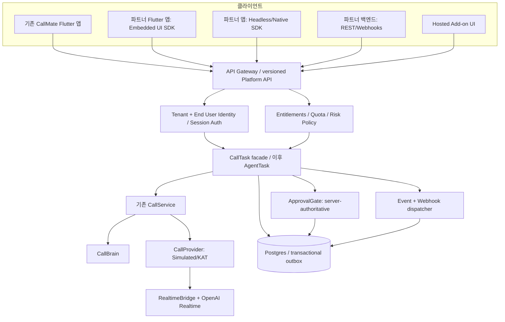
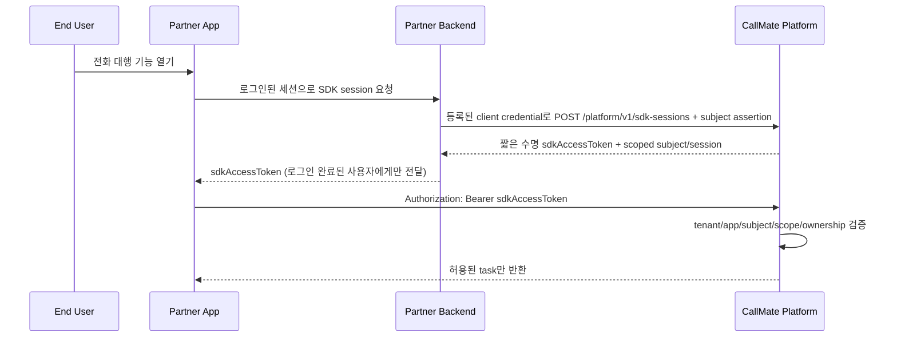

# CallMate SDK / Add-on 플랫폼 확장 아키텍처 v1.0

> 상태: **신규 확장 제안(미구현)**. 기준: `SOURCE_ARCHITECTURE.md`의 Flutter/Riverpod, Fastify, `CallService`, `CallProvider`, `CallBrain`, KAT Cloud, OpenAI Realtime, JSON `TaskStore`, REST/WS 전체 스냅샷과 `version`; `SOURCE_PRODUCT_ROADMAP.md`의 ApprovalGate, 커넥터, AgentTask. 실제 코드/외부 서비스 계약은 Cursor Step 0에서 검증.

## 1. 목표, 비목표, 설계 원칙

**목표**: CallMate 자체 Flutter 앱은 first-party client로 유지하면서 타사 Flutter·iOS·Android·Web/BFF가 AI 전화 대행, 진행상황, 승인, 결과, 이후 커넥터·AgentTask를 기능별로 연동할 수 있도록 **하나의 서버 플랫폼**을 제공한다.

**비목표(초기)**: KAT/OpenAI 비밀키를 SDK 안에 탑재, 앱별로 음성 브리지를 복제, 외부 앱에 전화 공급자 직접 접근 허용, 결제 자동 집행, 모든 네이티브 플랫폼 동시 지원, 고객사에 규정 준수를 보장하는 행위.

원칙: (1) business core와 presentation 분리, (2) 서버 승인 집행 및 idempotency, (3) tenant/host/end-user의 구분, (4) 통합 API는 버전 관리, (5) 제공 방식별 동일 상태/안전 계약, (6) 기존 MVP 통화 경로 비파괴 변경.

## 2. 제품/개발자용 제공 모델

| 채널 | 배포 형태 | 호스트 책임 | CallMate 책임 | 최초 제공 |
|---|---|---|---|---|
| 독립 앱 | 기존 Flutter 앱 | 자체 로그인/UX | 서버+엔진 | 유지 |
| Embedded UI SDK | Flutter package: Widget + controller | 로그인/화면 진입, 앱 내 내비게이션, 알림 연동 | 통화 UI 구성요소, 세션/승인 API | **1차** |
| Headless SDK | Flutter/Dart package (데이터·이벤트만) | 완전 맞춤 UI/접근성 | 인증된 API client/typed models/stream | **1차** |
| Hosted Add-on | CallMate가 호스팅한 위임 화면 + 짧은 수명 launch ticket | 버튼/메뉴, 안전한 화면 열기/복귀 | 화면·사용자 작업 수행 | 2차 |
| REST/Webhook API | 서버간/서버경유 API | 자체 백엔드, 서명/재시도 수신 | API 계약, 권한, 웹훅 발송 | 1~2차 |
| Native SDK | Swift Package / Android Kotlin wrapper | OS별 integration | 같은 REST/stream 계약 래핑 | 실제 수요 이후 |

**권장 패키지**: `packages/callmate_dart` (HTTP+models+event stream), `packages/callmate_flutter` (headless package를 사용하는 UI Widget). 플랫폼별 wrapper는 나중에 이 두 계층과 API 스펙을 공유한다. **공용 Dart 코드의 중복을 피한다.** 기존 앱은 UI 패키지의 첫 소비자가 되되, 첫 단계에서는 전면 재작성 없이 특정 승인/통화 화면부터 추출한다.

## 3. 논리적 시스템 구성



**구현 시점**: 처음에는 기존 Fastify monolith 내부에 `/platform/v1` 라우트/서비스를 추가하는 *modular monolith*; 마이크로서비스 분리 금지. 원래 `/v1/tasks`는 그대로 유지. 공유 `CallService`를 일관된 권한 검사 facade 아래에서 호출한다. 실제 코드베이스 검증 후 경로는 조정 가능.

## 4. 경계 및 데이터 소유권

- **Tenant**: CallMate 플랫폼 고객사/파트너 계약 단위. `tenantId`는 인증 principal에서 도출; 클라이언트가 보낸 값 신뢰 금지.
- **Partner App / Client**: 등록된 `appId`, 허용된 callback/deep link, SDK 기능 entitlement, 테스트/운영 환경을 가진 애플리케이션.
- **End User**: 파트너 앱의 개별 사용자를 매핑한 `externalSubject` → CallMate 내부 `userId`; 고객사가 `userId`를 임의로 지정 못함. 식별자는 tenant 내부 유일.
- **CallTask**: 기존 통화 도메인(상태/version/승인/자막/요약), owner tenant/user 바인딩. 차기 `AgentTask`는 여러 CallTask/커넥터 액션을 조합.
- **Approval**: 특정 `taskId`, `approvalId`, `actionDigest`, `expiresAt`, `userId`, `tenantId`, `status`, `decision`, `comment`에 바인딩. 승인 전 상태에서만 원자적으로 전이.
- **Integration**: `appId`, 허용 기능, 환경, 과금/제한, permitted origins(웹) 및 callback 대상.
- **Webhook Subscription/Delivery**: tenant 소유와 서명키 버전, 이벤트 ID, 전달 이력/재시도 상태. 비공개 callback URL 허용 금지 및 SSRF 방어.

### 권장 Postgres 테이블(논리 초안)

```text
tenants, partner_apps, end_users, external_subject_links,
sdk_sessions, call_tasks, call_sessions, approval_requests,
task_events, webhook_subscriptions, webhook_deliveries,
usage_records, audit_events, tenant_entitlements,
connector_accounts (B phase 이후)
```

`call_tasks`는 기존 JSON 저장에서 안전하게 이관하고 `tenant_id`, `user_id`, `version`을 소유. PII는 저장 최소화/암호화·보관기간 정책 적용. 기존 `TaskStore` 추상화 유지. 기존 파일 저장소로 **서로 다른 고객사 실사용 운영을 허용하지 않는다**.

## 5. 인증 및 권한 모델 (필수 출시 차단 조건)



- 파트너 BFF 서버의 client secret 또는 private key **모바일/웹 SDK 저장 금지**. 권장: 파트너 BFF → CallMate server-to-server 인증(OIDC client authentication/mTLS 중 선택) → 단기, audience-bound, user-scoped SDK access token 발급. **서버측 파트너 사용자 인증과 subject mapping 신뢰 계약** 필요.
- 토큰 claims의 예: `iss`, `aud`, `sub`, `tenant_id`, `app_id`, `scope`, `iat`, `exp`, `jti`; provider별 검증, 환경 분리, 회수/로테이션 설계.
- Web SDK는 Authorization 헤더 또는 BFF 프록시 사용. WebSocket query 장기 토큰 금지; 제한된 일회성 stream ticket 또는 인증 가능한 transport로 설계.
- 외부 API는 매 요청 **tenant + app + end user + resource owner + entitlement** 검사. 인증 실패 401, 권한 실패 403, 다른 tenant 리소스는 404 처리 고려. API 키는 사용자 권한 대체 불가.
- Hosted UI launch는 단일 사용, 짧은 만료, redirect allowlist, state/nonce 검증, replay 방어, PKCE 적용 가능성 검토; 웹뷰/딥링크에 영구 토큰 노출 금지.

## 6. 공개 API 계약 초안

내부 `/v1/tasks`와 별개인 외부 `/platform/v1` 공개 계약 (명칭은 구현 전 승인). `OpenAPI 3.1` 스펙으로 정의하고 typed SDK 생성 또는 계약 테스트에 사용. **서버 구조체를 그대로 공개하지 않는다**. 최소화된 공개 DTO로 PII 노출 제어.

| 메서드 | API | 기능 |
|---|---|---|
| POST | `/platform/v1/sdk-sessions` | **BFF 전용** 단기 end-user scoped session 발급 |
| POST | `/platform/v1/call-tasks` | 전화 작업/계획 생성, Idempotency-Key 권장 |
| GET | `/platform/v1/call-tasks/{taskId}` | 소유 작업 상태/요약 조회 |
| POST | `/platform/v1/call-tasks/{taskId}/approve-plan` | 통화 발신 전 명시 승인 |
| POST | `/platform/v1/call-tasks/{taskId}/cancel` | 중단/끊기 |
| POST | `/platform/v1/call-tasks/{taskId}/approvals/{approvalId}` | approve/reject + 선택 코멘트, 서버 승인 정책 집행 |
| GET | `/platform/v1/events` | task 상태/승인 변경 구독용 스트림-ticket 연계 |
| POST | `/platform/v1/event-tickets` | 짧은 수명 event stream ticket |
| POST | `/platform/v1/webhook-subscriptions` | BFF 전용 등록/검증/회수(권한 필요) |
| GET | `/platform/v1/capabilities` | tenant/app의 SDK 사용 허가 목록 |

**버전/에러**: stable API `/platform/v1`에서 요청·응답 문서화, `error.code`, `message`, `requestId`, `retryable` 사용. Breaking change는 `/platform/v2`로. `409 approval_closed` 및 현재 state/version에 기반한 동시성 규칙 유지. 페이지/필터/제한은 명시. rate-limit은 tenant/user/app 별로.

**이벤트 규약**: `eventId`, `eventType`, `occurredAt`, `tenantScopedTaskId`, `resourceVersion`, `payload`(최소화). SDK stream은 재연결 후 GET authoritative task로 복구; version 더 높은 snapshot만 채택. 서버간 webhooks는 서명, 전송 시각, replay 방어, 적어도 한 번(at-least-once) 전달; 파트너는 `eventId`로 중복 제거. delivery가 늦어도 승인 기한은 늘어나지 않음.

## 7. SDK API 형태 예시 (설계용 pseudocode, 패키지 미구현)

```dart
final client = CallMateClient(
  baseUrl: 'https://api.example.invalid',
  tokenProvider: () async => partnerBackend.issueScopedSdkToken(),
);
final task = await client.createCallTask(
  targetName: '식당',
  phoneNumber: '+82200000000',
  goal: '오늘 7시 예약 가능 여부 확인',
  idempotencyKey: requestId,
);
// 서버 authoritative stream + reconnect GET
client.watchTask(task.id).listen((snapshot) { /* UI render */ });
await client.respondToApproval(
  taskId: task.id, approvalId: approvalId,
  decision: ApprovalDecision.approve,
  comment: '3만원 이하만 가능',
);
```

```dart
CallMateCallFlow(
  client: client,
  onCompleted: (result) => partnerAppNavigate(result),
  onExit: () => partnerAppClose(),
)
```

- Headless `CallMateClient`는 UI/Flutter framework에 의존하지 않음. `callmate_flutter` UI는 호스트 앱의 테마, localization, Navigator, accessibility 및 브랜드 노출 옵션을 지원.
- 위젯 렌더링과 승인 권한은 별개. 서버가 승인/거절/만료를 결정하고 **서버 응답을 기준**으로 UI를 닫는다.
- Dart SDK가 서버 전화 회선·미디어를 직접 다루지 않는다. 푸시는 호스트 앱의 알림 시스템에 통합할 수 있는 이벤트/라우팅 콜백만 우선 제공.

## 8. 백엔드 재구성 (증분 추출)

```text
server/src/
  platform/
    http/                   # 공개 API + OpenAPI validators
    auth/                   # tenant/app/end-user session authorization
    entitlements/           # plan/capabilities/quota
    facades/                # CallTaskFacade → 기존 CallService
    webhooks/               # subscriptions, outbox delivery, signatures
    events/                 # public event projection
    dto/                    # stable external API objects
  services/callService.ts    # 기존 유지
  providers/                # 기존 유지
  store/                    # 기존 유지/교체 가능한 포트
packages/
  callmate_dart/            # Dart models/HTTP/events, UI independent
  callmate_flutter/         # reusable widgets, depends on callmate_dart
  callmate_sdk_example/     # partner integration test host app
specs/
  openapi.platform.v1.yaml
```

`ApprovalGate`는 독립 컴포넌트지만 정책 결정을 `platform/`에 복제하지 말 것. 기존 승인 동작은 공통 서비스에서 수행. 서비스와 SDK는 OpenAPI 계약테스트로 연동하고 실제 KAT 통화는 opt-in만.

## 9. Embedded UI / Hosted Add-on 인터페이스

**UI 컴포넌트 단위**: `CallRequestForm`, `CallPlanReview`, `CallProgressView`, `ApprovalCard`, `CallOutcomeView`를 필요한 수준으로 export. 외부 앱은 `CallMateCallFlow` 전체 또는 개별 위젯을 선택. 호스트는 `onExit/onCompleted/onError`, 테마/locale, 권한 설명, error mapper를 제공.

**Hosted**: (1) 호스트 서버가 launch ticket을 만들고 (2) 앱이 안전한 URL/Custom Tab 또는 지원되는 통합 방식으로 열며 (3) CallMate가 사용자의 task를 수행하고 (4) 등록된 callback으로 *task reference만* 반환, (5) 파트너 BFF가 서버에서 최종 결과 확인. callback query에 상세 자막/토큰 금지. 브라우저·OS의 제3자 쿠키 제약 고려.

## 10. 운영·과금·개발자 경험

- Developer portal: sandbox/production 앱 등록, 테스트 tenant, API docs, webhook secret 회전, callback allowlist, usage/quota, credential audit, 키 관리 UI (후속).
- Usage meter: 통화 시작/연결/종료, 통화 길이, Realtime 사용량/실패, 중복 청구 방지를 위한 usage event key. 과금액은 정책 결정 전 미구현.
- Tenant별 rate limit, 동시 통화, 일일 비용 상한, 서킷 브레이커, kill switch, 재시도/쿼터·KAT 한국 IP 제약, SLA 관측 및 structured requestId/taskId.
- Sandbox는 `SimulatedCallProvider`와 가짜 계정/콜백을 기본 사용; 운영 자격증명 없이 E2E 가능. 외부 고객에게 실전화 테스트를 기본 허용하지 않음.
- 개인정보: 전화번호, 자막, 사용자 코멘트는 최소 공개/보관. 삭제·export와 제3자 처리 위탁/전송, AI 고지/녹음·자막 법률 검토가 계약상 출시 전제.

## 11. 단계별 구축 계획 / 강제 게이트

| 단계 | 작업 | 의존성/출시 게이트 | 산출물 |
|---|---|---|---|
| S0 | 현행 repo/권한/인터페이스 감사 + 공개 API 요구사항 정리 | 코드 확인, 기존 테스트 | integration boundary report |
| S1 | API contract/OpenAPI + DTO 분리 + facade 설계 | 기존 `/v1` 회귀 | OpenAPI, mocked contract tests |
| S2 | Headless Dart SDK + 예제 앱 **sandbox only** | S1, simulated provider | Dart package + example + widget-free tests |
| S3 | Flutter UI SDK + 기존 CallMate 앱에서 점진 채택 | S2 | Flutter package + integration/widget tests |
| S4 | 계정·tenant/app/user/owner·Postgres·rate/entitlement | **외부 앱 운영 노출 전에 반드시** | isolation/abuse tests, migrations |
| S5 | 공개 Platform API, webhooks, stream tickets, developer sandbox | S4, 인증·서명 검증 | public API & docs |
| S6 | Hosted Add-on, developer portal, 과금 계측 | S5 | Hosted launch/callback, audit |
| S7 | Native wrappers/커넥터/AgentTask SDK 확장 | 수요·법적/기술 검증 | 추가 패키지/버전 정책 |

**순서 주의**: S1–S3은 internal/mock-only로 A1~A5와 병행 가능. **외부 파트너 실사용**은 S4 이후, S5 인증·소유권·보안 테스트 이후에만 허용. B0의 계정 기반 도입 일정은 SDK 외부 출시 게이트로 앞당겨짐.

## 12. SDK 수용 기준

1. 기존 CallMate 앱/시뮬레이터/실통화 API 하위 호환성 보존; 테스트에서 MockProvider를 사용.
2. 파트너 A 로그인 사용자가 파트너 B/타 사용자 task/approval/transcript 접근 불가 (REST + WS + webhook + Hosted 모두).
3. 재시도·중복 요청 시 실발신/고위험 실행이 중복되지 않음. callback은 신뢰 근거가 아님.
4. 승인 만료/거절/수정 코멘트/재연결에서 안전한 상태. 호스트 앱이 승인 UI를 바꿔도 권한 정책 우회 불가능.
5. SDK 사용 예제는 비밀키 없이 sandbox provider로 작동하며, 앱 종료/재시작/네트워크 장애 시 작업 조회/복구 가능.
6. PII가 푸시/웹훅/URL/로그에 과다 노출되지 않고 삭제·보관 정책이 검증됨.
7. `openapi` spec 버전 변경 시 SDK contract tests/semver/changelog/마이그레이션 가이드가 배포됨.

## 13. 미확정 사항 (확정 전 구현 가정 금지)

- 최초 지원 파트너 앱 언어(Flutter 먼저라는 **제안**; 실제 파트너가 Kotlin/Swift/React Native인지 파악 필요)
- 파트너 BFF 보유 여부/SSO 방식, 테넌트 매핑 신뢰 계약
- 앱에 노출할 CallMate 브랜드/사용료/통화 발신번호/호스트 앱 동의 UX
- 외부 파트너의 녹음/자막 제공 범위와 보관기간, 국내 법률·통신사업자 재판매/재위탁 허용 범위
- Hosted UI 사용 시 WebView/Custom Tab/외부 브라우저 지원 및 콜백 보안 정책
- 외부 인프라 지역, KAT Korea IP 제한과 망·처리위탁 조건
