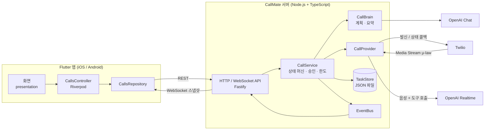
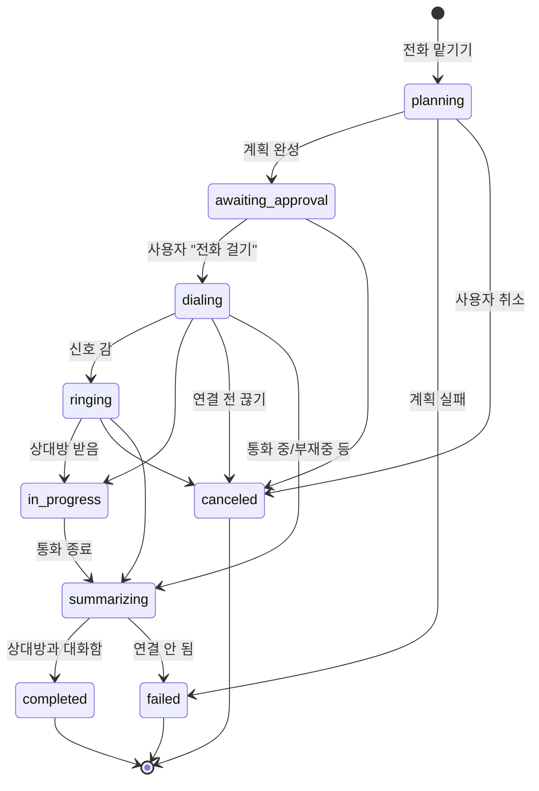
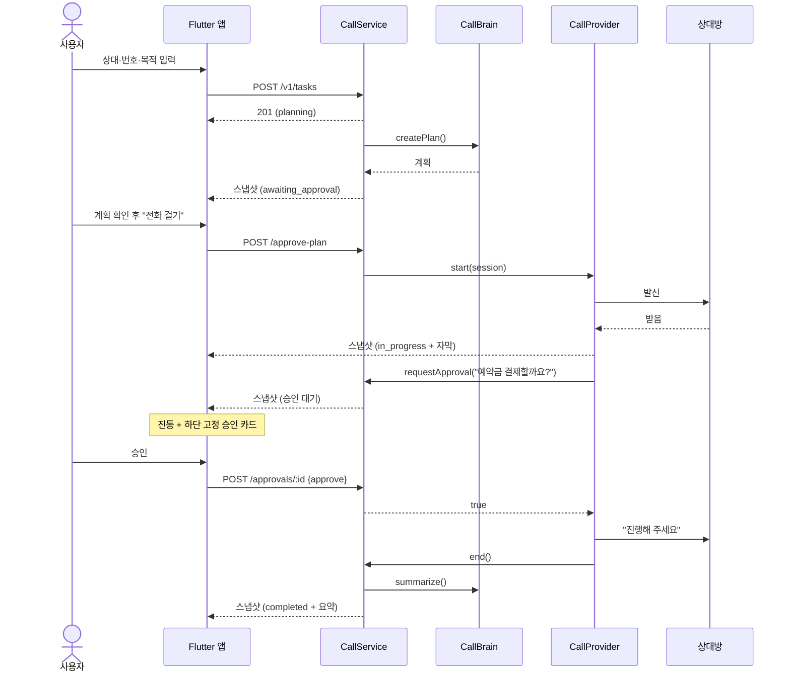

# CallMate 아키텍처 설계서

> AI가 사용자를 대신해 전화를 걸고, 통화 중 중요한 결정은 사용자에게 묻고, 결과를 정리해 주는 개인 비서 앱

## 1. 목표와 범위

### 1.1 제품 목표

| 목표 | 설명 |
| --- | --- |
| 전화 대행 | 예약, 문의, 요금 할인, 취소·환불처럼 "전화로만 되는 일"을 AI가 대신 처리 |
| 사용자 통제 | 전화 걸기 전 통화 계획을 검토하고, 통화 중 결제·약정·수수료는 반드시 사용자 승인 |
| 투명성 | 통화 내용을 실시간 자막으로 보여 주고, 끝나면 결과·알아낸 내용·할 일을 요약 |
| 안전 | AI임을 먼저 밝히고, 민감 정보(카드번호, 비밀번호 등)는 절대 말하지 않음 |

### 1.2 이번 버전(MVP) 범위

- 포함: 전화 맡기기, 통화 계획 생성·검토, 발신, 실시간 자막, 통화 중 승인, 결과 요약, 통화 기록, 설정
- 포함: 키 없이 전체 흐름을 체험할 수 있는 **통화 시뮬레이터**
- 제외(로드맵): 푸시 알림, 다중 사용자 계정, 수신 전화, ARS 메뉴 탐색, 예약 통화, 캘린더 연동

---

## 2. 핵심 설계 결정

### 2.1 전화는 휴대폰이 아니라 서버가 건다

iOS와 Android 모두 앱이 일반 전화 통화의 음성을 가로채거나 AI 음성을 넣는 것을 허용하지 않습니다.
그래서 Pickle, Google Duplex 같은 서비스도 모두 **서버에서 전화망(PSTN)으로 발신**합니다.

```text
[Flutter 앱] ──REST/WebSocket──> [CallMate 서버] ──Twilio──> 전화망 ──> 상대방 전화기
                                       │
                                       └──WebSocket──> OpenAI Realtime (음성 AI)
```

이 결정 덕분에 앱은 iOS와 Android에서 **같은 코드**로 동작하고, 특별한 권한(마이크, 전화)이 필요 없습니다.

### 2.2 통화 공급자는 교체 가능한 전략(Strategy)으로

`CallProvider` 인터페이스 뒤에 두 구현을 둡니다.

| 구현 | 언제 | 역할 |
| --- | --- | --- |
| `SimulatedCallProvider` | 키가 없을 때(기본값) | 시나리오 기반 가상 통화. 개발·데모·테스트용 |
| `TwilioCallProvider` | Twilio + OpenAI 키가 모두 있을 때 | 실제 발신 + 음성 AI 연결 |

국내 통신사 기반 CPaaS로 바꾸고 싶다면 `CallProvider`만 새로 구현하면 됩니다. 상태 관리·승인·요약 로직은 그대로 재사용됩니다.

### 2.3 "두뇌"도 교체 가능하게

통화 전 계획과 통화 후 요약은 `CallBrain` 인터페이스가 담당합니다.

- `OpenAiBrain`: LLM이 목적에 맞는 계획과 요약을 생성 (실패 시 자동으로 규칙 기반으로 대체)
- `HeuristicBrain`: 키워드(예약/요금/취소/문의)로 시나리오를 판별하는 규칙 기반. 결정적이라 테스트에 사용

### 2.4 서버가 유일한 진실 공급원, 이벤트는 "전체 스냅샷"

서버는 작업이 바뀔 때마다 **작업 전체**를 WebSocket으로 보냅니다(diff가 아님).
앱은 받은 것으로 교체만 하면 되므로, 메시지를 놓쳐도 다음 메시지로 자동 복구됩니다.

각 작업에는 변경할 때마다 1씩 증가하는 `version`이 있어, HTTP 응답과 WebSocket 이벤트가 **순서가 뒤바뀌어 도착해도** 앱은 항상 더 높은 버전을 유지합니다.

---

## 3. 시스템 구성



---

## 4. 기능 분해

| ID | 기능 | 사용자 관점 | 담당 모듈 |
| --- | --- | --- | --- |
| F1 | 내 정보 설정 | 이름·회신번호 입력 (AI가 "○○님을 대신해" 소개) | 앱 `settings` |
| F2 | 전화 맡기기 | 상대 이름·번호·목적·공유 가능 정보 입력, 템플릿 선택 | 앱 `calls/new_call_screen`, 서버 `POST /v1/tasks` |
| F3 | 통화 계획 생성 | 첫 인사, 통화 순서, 물어볼 것, 승인 지점, 대안 | 서버 `CallBrain.createPlan` |
| F4 | 계획 검토·수정 | 첫 인사 수정 후 "이대로 전화 걸기" | 앱 `call_detail_screen`, 서버 `approve-plan` |
| F5 | 발신·연결 | 연결 중 → 신호 가는 중 → 통화 중 | 서버 `CallProvider.start`, 상태 콜백 |
| F6 | 실시간 자막 | AI와 상대방 대화를 채팅처럼 표시, 통화 시간 | 서버 `appendTranscript` → 스트림, 앱 `TranscriptView` |
| F7 | 통화 중 승인 | 상대방을 잠시 기다리게 하고 사용자에게 승인/거절 요청, 제한 시간 | 서버 `requestApproval`, 앱 `ApprovalCard`, `ApprovalListener` |
| F8 | 통화 끊기 | 사용자가 언제든 통화 종료 | 서버 `cancel` → `hangup` |
| F9 | 결과 요약 | 결과(달성/일부/실패), 요약, 알아낸 내용, 할 일 | 서버 `CallBrain.summarize`, 앱 `OutcomeCard` |
| F10 | 통화 기록 | 진행 중/지난 통화 목록, 다시 걸기, 삭제 | 앱 `home_screen` |
| F11 | 안전장치 | AI 고지, 민감정보 차단, 긴급번호 차단, 동시·일일 한도, 최대 통화 시간 | 서버 `prompts`, `phone`, `CallService` |

---

## 5. 모듈 분해

### 5.1 서버 (`server/src`)

| 경로 | 책임 | 의존 |
| --- | --- | --- |
| `config.ts` | 환경변수 검증(zod), 공급자 자동 선택, 실제 통화 시 `API_TOKEN` 강제 | - |
| `domain/types.ts` | `CallTask`, `CallPlan`, `ApprovalRequest`, `CallOutcome` 타입 | - |
| `domain/stateMachine.ts` | 허용된 상태 전이만 통과 | types |
| `domain/phone.ts` | 번호 정규화(E.164, 한국 번호 기본), 긴급번호 차단, 로그용 마스킹 | - |
| `brain/` | 계획·요약(`OpenAiBrain`, `HeuristicBrain`), 음성 AI 지시문(`prompts.ts`) | domain |
| `providers/types.ts` | `CallProvider` / `CallSession` 계약 | domain |
| `providers/simulatedProvider.ts` | 시나리오 기반 가상 통화 | brain/scenario |
| `providers/twilio/twilioProvider.ts` | Twilio 발신, 상태 콜백 서명 검증, Media Stream 인증 | twilio SDK |
| `providers/twilio/realtimeBridge.ts` | Twilio 오디오 ↔ OpenAI Realtime 중계, 도구 호출 처리, 끼어들기(barge-in) | ws |
| `services/callService.ts` | 작업 생명주기, 승인 대기/만료, 한도, 요약 트리거, 재시작 복구 | 위 전부(인터페이스로) |
| `store/taskStore.ts` | 메모리 + JSON 파일 원자적 저장(임시 파일 → rename) | - |
| `events/eventBus.ts` | 작업 스냅샷 발행/구독 | - |
| `http/` | REST·WebSocket 라우트, 입력 검증, 인증, 오류 매핑 | services |
| `container.ts` | 설정에 따라 구현체를 조립하는 유일한 곳 | 전부 |

의존 방향은 항상 `http → services → (brain, providers, store)` 이고, `services`는 구현체가 아니라 인터페이스에만 의존합니다.

### 5.2 Flutter 앱 (`app/lib`)

기능(feature) 단위로 폴더를 나누고, 각 기능 안에서 계층을 나눕니다.

```text
lib/
  main.dart                  # SharedPreferences·날짜 포맷 초기화 후 ProviderScope 실행
  app.dart                   # MaterialApp.router, 테마, 전역 승인 알림
  core/
    config/app_settings.dart # 서버 주소·토큰·내 정보 (SharedPreferences)
    network/api_client.dart  # HTTP 래퍼, 서버 오류 코드 → 한국어 메시지
    network/live_channel.dart# 자동 재연결 WebSocket (지수 백오프)
    router/app_router.dart   # go_router 경로
    theme/, utils/, widgets/ # 공통 UI
  features/
    calls/
      domain/                # 모델 + fromJson (서버 계약과 1:1)
      data/                  # CallsRepository: URL·와이어 포맷을 아는 유일한 곳
      application/           # CallsController: REST 초기 로드 + 실시간 스냅샷 병합
      presentation/          # 홈, 전화 맡기기, 통화 상세(단계별 화면), 위젯
    settings/                # 설정 화면, 연결 테스트
```

| 계층 | 규칙 |
| --- | --- |
| `domain` | Flutter 위젯에 의존하지 않는 순수 Dart |
| `data` | 서버 경로와 JSON 형식은 여기에만 존재 |
| `application` | 화면이 읽는 상태의 단일 출처. 화면은 `ref.watch`만 함 |
| `presentation` | 상태를 그리고, 사용자 행동을 controller 메서드로 전달 |

---

## 6. 통화 상태 머신



- 전이 규칙은 `domain/stateMachine.ts` 한 곳에 있고, 규칙 밖 전이는 예외로 막습니다.
- 서버가 재시작되면 진행 중이던 작업은 `failed`로 표시해, 사용자가 무한히 기다리지 않게 합니다.

---

## 7. 핵심 흐름

### 7.1 전화 맡기기부터 결과까지



### 7.2 실제 통화의 음성 경로 (Twilio + OpenAI Realtime)

1. 서버가 Twilio REST API로 발신하면서 TwiML `<Connect><Stream>`을 넘깁니다.
2. 상대방이 받으면 Twilio가 서버의 `/twilio/media` WebSocket으로 8kHz μ-law 오디오를 보냅니다.
   - Twilio는 스트림 URL의 쿼리를 버리므로, 작업 ID와 **1회용 토큰**을 `<Parameter>`로 보내고 서버가 상수 시간 비교로 검증합니다.
3. 서버는 같은 μ-law 형식으로 OpenAI Realtime에 그대로 전달합니다(변환 없음 → 지연 최소화).
4. AI 음성은 반대 방향으로 Twilio에 전달되고, 상대방이 말을 시작하면 `clear`로 AI 음성을 즉시 멈춥니다(끼어들기).
5. 양쪽 발화의 텍스트 변환 결과가 자막으로 저장·방송됩니다.
6. AI는 두 개의 도구만 쓸 수 있습니다.
   - `request_user_approval(question)`: 사용자 승인 대기 → 결과를 AI에 돌려줌
   - `end_call(reason)`: 작별 인사 음성이 전달될 시간을 두고 통화 종료
7. Twilio 상태 콜백(`/twilio/status/:id`)은 `X-Twilio-Signature` 서명을 검증한 뒤에만 처리합니다.

---

## 8. API 명세

모든 `/v1` 경로는 `Authorization: Bearer <API_TOKEN>`이 필요합니다(설정한 경우). WebSocket은 브라우저 제약 때문에 `?token=`도 허용하며, 로그에서는 가려집니다.

| 메서드 | 경로 | 설명 |
| --- | --- | --- |
| GET | `/health` | 헬스 체크 |
| GET | `/v1/config` | `{ provider, brain, realCalls }` |
| GET | `/v1/tasks` | 작업 목록 |
| POST | `/v1/tasks` | 작업 생성 → 계획 시작 |
| GET | `/v1/tasks/:id` | 작업 조회 |
| POST | `/v1/tasks/:id/approve-plan` | 계획 승인 + 발신 (첫 인사 수정 가능) |
| POST | `/v1/tasks/:id/cancel` | 취소 또는 통화 끊기 |
| POST | `/v1/tasks/:id/approvals/:approvalId` | `{ decision: "approve" \| "reject" }` |
| DELETE | `/v1/tasks/:id` | 끝난 작업 삭제 |
| WS | `/v1/stream` | `snapshot`, `task.updated`, `task.deleted` |

오류는 `{ error: 코드, message }` 형식이며, 앱은 코드별 한국어 메시지를 보여 줍니다.

| 코드 | HTTP | 의미 |
| --- | --- | --- |
| `invalid_request` / `invalid_phone` / `blocked_number` | 400 | 입력 오류 |
| `unauthorized` | 401 | 토큰 오류 |
| `invalid_state` / `approval_closed` | 409 | 지금 상태에서 불가 |
| `too_many_active_calls` / `daily_limit` | 429 | 한도 초과 |

---

## 9. 데이터 모델

```ts
interface CallTask {
  id: string;
  version: number;              // 변경마다 +1 (순서 역전 대비)
  status: TaskStatus;
  targetName: string;           // 상대 이름
  phoneNumber: string;          // E.164 (+8221234567)
  goal: string;                 // 부탁한 일
  context?: string;             // 상대에게 공유해도 되는 정보
  language: "ko" | "en";
  requesterName: string;
  callbackNumber?: string;
  plan?: CallPlan;
  transcript: TranscriptEntry[];
  approvals: ApprovalRequest[];
  outcome?: CallOutcome;
  error?: string;
  provider: "simulated" | "twilio";
  createdAt: string;
  startedAt?: string;
  connectedAt?: string;
  endedAt?: string;
}
```

저장소는 `TaskStore` 인터페이스 뒤에 있어, 다중 사용자 단계에서 Postgres 구현으로 교체할 수 있습니다.

---

## 10. 안전·법적 고려사항

| 항목 | 이번 구현 | 비고 |
| --- | --- | --- |
| AI 고지 | 첫 문장에서 AI 비서임을 밝히도록 지시문에 강제 | 여러 국가·주에서 AI 발신 고지가 의무화되는 추세 |
| 사용자 승인 | 결제·약정·수수료·예약 확정은 `request_user_approval` 없이는 불가. 무응답은 **거절**로 처리 | 기본값을 "안전한 쪽"으로 |
| 민감 정보 | 카드번호·비밀번호·주민번호·인증번호는 말하지 않도록 지시 | 공유 정보는 사용자가 입력한 것만 |
| 긴급·특수번호 | 112, 119 등 차단 | `domain/phone.ts` |
| 남용 방지 | 동시 통화 수, 24시간 통화 수, 최대 통화 시간 제한 | 환경변수로 조정 |
| 인증 | 실제 통화 모드에서는 `API_TOKEN` 없으면 서버가 시작되지 않음 | 유료 API 보호 |
| 개인정보 | 로그에 전화번호는 마스킹, 토큰은 가림 | 녹음은 저장하지 않고 자막만 저장 |
| 녹음·자막 | 자막을 저장하므로 서비스 약관과 개인정보 처리방침에 고지 필요 | 출시 전 법률 검토 필요 |

> 국가별 통화 녹음·AI 발신 규정은 다르고 계속 바뀝니다. 실제 서비스 출시 전에는 반드시 법률 검토가 필요합니다.

---

## 11. 한국에서 실제 통화를 걸 때의 과제

- Twilio로 한국 번호에 발신은 가능하지만, 발신번호가 해외 번호로 표시되어 상대방이 받지 않거나 스팸으로 분류될 수 있습니다.
- 한국 발신번호(070/1588 등)를 쓰려면 국내 통신사 기반 CPaaS가 필요할 수 있습니다. 어떤 업체가 실시간 오디오 스트리밍을 지원하는지는 **추가 조사가 필요**합니다.
- 구조상 `CallProvider`만 새로 구현하면 되므로, 나머지 코드는 바꿀 필요가 없습니다.

---

## 12. 로드맵

| 단계 | 내용 | 변경 범위 |
| --- | --- | --- |
| 1 | 푸시 알림(FCM/APNs): 앱이 백그라운드여도 승인 요청을 받음 | 서버 알림 모듈 + 앱 `firebase_messaging` |
| 2 | 사용자 계정·다중 사용자, Postgres 저장소 | `TaskStore` 구현 교체, 인증 미들웨어, 작업 소유자 검사 |
| 3 | 연락처에서 상대 선택, 장소 검색으로 번호 자동 입력 | 앱 권한 + 검색 API |
| 4 | ARS 메뉴 탐색(DTMF), 자동응답기 감지 | `realtimeBridge` 도구 추가, Twilio AMD |
| 5 | 예약 통화, 캘린더 연동, 결과를 캘린더에 등록 | 스케줄러 + Google Calendar OAuth |
| 6 | 국내 CPaaS 공급자 | 새 `CallProvider` 구현 |
