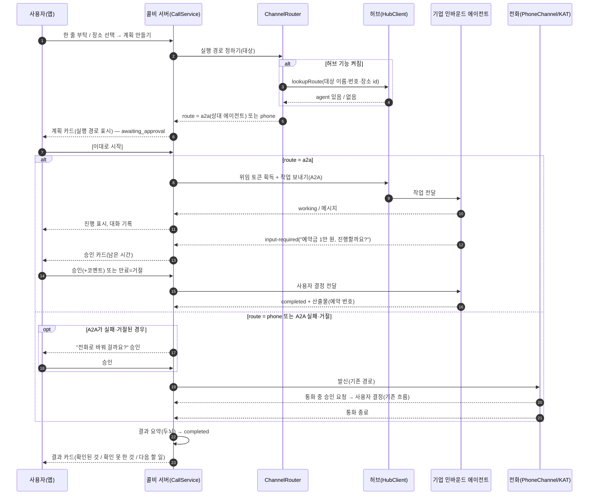
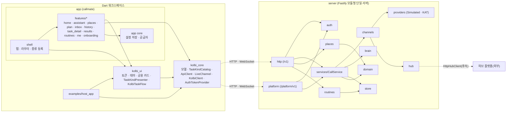

# 11. 설계서 — 콜비(Kolbi) 앱·서버·허브·SDK 아키텍처

- 작성일: 2026-11-26, 작성: jason (manager-spec)
- 문서 성격: 콜비 앱을 모듈화하고, 작업 종류·실행 채널·허브(A2A)·SDK로 넓히기 위한 설계. 제품 범위는 `10_PRODUCT_PLAN.md`, 구현 순서는 `12_IMPLEMENTATION_PLAN.md`.
- 근거: 현재 코드(인용한 `path:line`은 2026-11-26 작업 트리 기준), `docs/planning/03_SERVICE_FEATURE_PLAN.md`(이하 "03"), `docs/planning/04_DESIGN_PLAN.md`(이하 "04"), `docs/04_SDK_ADDON_PLATFORM_ARCHITECTURE.md`(이하 "SDK 제안"), `.moai/project/{product,structure,tech}.md`.
- 표기: **가정**은 근거 없이 둔 설계 전제, **검증 필요**는 외부 계약(허브, A2A 세부 필드, 외부 API)과 맞춰 보아야 하는 항목이다. 코드 조각은 모양을 보이기 위한 설계용 의사 코드이며 최종 이름은 각 SPEC의 run 단계에서 정한다.
- 개정 이력
  - 2026-11-26: 디자인 검토 반영(`docs/planning/06_DESIGN_DECISIONS.md`, 이하 "06"). 셸 5갈래와 `assistant`·`history` 모듈(§2.5), `kolbi_ui`의 Agent 컴포넌트와 Midnight Indigo 토큰·Pretendard(§2.3), 업무·기록 묶음 규칙(§3.5), 업무 실행 단계 계산(§3.6), Theme Override(§7.2), 결정 AD-8~AD-10(§10).

---

## 1. 출발점 — 지금 코드의 모양

### 1.1 앱(`app/`)

- 패키지 하나(`name: callmate`, `app/pubspec.yaml:1`), Flutter 3.50.1, Riverpod 3(`flutter_riverpod: ^3.5.0`), go_router, `package:material_ui/material_ui.dart`.
- 소스 29개 파일. `core/`(설정·네트워크·라우터·테마·유틸·공용 위젯)와 `features/calls/`(domain·data·application·presentation), `features/settings/`.
- 테스트 11개 파일, 테스트 선언 80개. 2026-11-26 `flutter --suppress-analytics test` 실행 결과: `+80: All tests passed!`.
- 확장을 막는 결합(코드로 확인):

| 위치 | 결합 | 근거 |
|---|---|---|
| 도메인 모델 | `call_models.dart`·`intake_models.dart`·`counterparties.dart`가 `@immutable` 하나 때문에 `package:flutter/foundation.dart`를 가져온다 | `app/lib/features/calls/domain/call_models.dart:1`, `:73` |
| 승인 코멘트 | 순수 함수(`codePointLength`, `hasSensitiveDigits`)와 입력 포매터(`TextInputFormatter`)가 한 파일에 있다 | `app/lib/features/calls/domain/approval_comment.dart:17`, `:34`, `:68` |
| 저장소 | 서버 접근 클래스(`CallsRepository`)와 Riverpod 공급자(`apiClientProvider`)가 한 파일에 있다 | `app/lib/features/calls/data/calls_repository.dart:29`, `:91` |
| 라우터 | `core/router/app_router.dart`가 모든 화면을 직접 가져온다(셸 역할을 `core`가 하고 있음) | `app/lib/core/router/app_router.dart:4-11` |
| 기능 간 | 설정 화면이 통화 기능의 화면 조각(`trust_notice.dart`)을 가져온다 | `app/lib/features/settings/settings_screen.dart:10` |
| 승인 카드 | 위젯이 앱 상태(`calls_controller.dart`)를 직접 읽는다 | `app/lib/features/calls/presentation/widgets/approval_card.dart:10` |
| 공용 위젯 | `describeError`가 네트워크 예외 타입을 안다 | `app/lib/core/widgets/common.dart:3`, `:269` |

### 1.2 서버(`server/`)

- Fastify/TypeScript 모듈형 단일 서버. 방향: `http → services → brain/providers/store → domain`, 조립은 `container.ts` 한 곳(`server/src/container.ts:22`).
- 실행 경계는 `CallProvider`(`server/src/providers/types.ts:71`)와 `CallSession`(`:49`). 상태는 `TaskStatus` 9개(`server/src/domain/types.ts:3`), 전이 표는 `server/src/domain/stateMachine.ts:3`.
- 인증은 `/v1/` 아래 전체에 Bearer 토큰 하나(`server/src/http/app.ts:140-142`). WebSocket은 `?token=`도 받는다(`:38-40`).
- 모듈 경계 테스트가 이미 있다(`server/src/architecture.test.ts`): HTTP 계층은 구체 제공자를 모르고, 제공자는 `brain/`을 가져오지 않는다.

이 설계는 서버의 이 방향과 테스트 방식을 그대로 넓히고, 앱에는 같은 수준의 경계를 새로 만든다.

---

## 2. 앱 모듈 구조

### 2.1 저장소 배치

Dart pub 워크스페이스 하나에 패키지 셋과 예제 하나를 둔다.

```
/ (저장소 루트)
├── pubspec.yaml              워크스페이스 루트(name: kolbi_workspace, workspace: [...])
├── pubspec.lock              워크스페이스 전체에 하나(지금의 app/pubspec.lock을 대신함)
├── packages/
│   ├── kolbi_core/           순수 Dart. 헤드리스 SDK. Flutter 의존 금지
│   └── kolbi_ui/             Flutter. 디자인 토큰·테마·공용 컴포넌트·임베드용 흐름
├── app/                      자체 앱 셸(지금 패키지 이름 callmate 유지)
├── examples/host_app/        SDK를 쓰는 최소 호스트 앱(SPEC-SDK-001에서 추가)
└── server/                   Node 서버(워크스페이스와 무관, 그대로)
```

루트 `pubspec.yaml`(SPEC-MODULE-001에서 만듦):

```yaml
name: kolbi_workspace
publish_to: none
environment:
  sdk: ^3.14.0
workspace:
  - app
  - packages/kolbi_core
  - packages/kolbi_ui
```

각 패키지의 `pubspec.yaml`에는 `resolution: workspace`를 둔다. 워크스페이스는 의존성 해석을 하나로 묶어 패키지 사이 버전 어긋남을 막고, `flutter test`는 지금처럼 `app/`에서 실행한다(가정 A-1, SPEC-MODULE-001 M1에서 확인).

### 2.2 이름 결정

| 결정 | 내용 | 이유 |
|---|---|---|
| 새 패키지 접두사 | `kolbi_` | 제품 이름 변경 방향(03 OD-12)과 맞춘다. 새로 만드는 이름을 `callmate_`로 지으면 곧 두 번 바꾼다 |
| 헤드리스 패키지 | `kolbi_core` | SDK 제안의 `callmate_dart`는 "언어"로 이름을 지어 Flutter 패키지(이것도 Dart)와 구분이 흐리다. `core`는 계층(UI 없음)을 말한다 |
| UI 패키지 | `kolbi_ui` | `callmate_flutter` 대신 역할(화면 구성 요소)로 이름을 짓는다 |
| 앱 패키지 | 지금은 `callmate` 유지 | 테스트 12개 파일이 `package:callmate/...`를 가져온다. 이름 변경은 기계적이고 되돌리기 쉬우므로 별도 SPEC으로 분리해 이번 구조 변경과 섞지 않는다(OD-K1) |
| 화면 제목 `CallMate` | 지금은 유지(`app/lib/app.dart:14`) | 표시 이름은 OD-12 결정과 함께 바꾼다 |
| 앱 이름(2026-11-26) | **콜비로 확정**(06 DR-1). 화면 안 워드마크 `kolbi.`는 SPEC-SHELL-001이 그리고, `MaterialApp.title`·OS 표시 이름·앱 패키지 이름은 OD-K1의 별도 SPEC에서 함께 바꾼다 | 이름 변경을 구조 변경과 섞지 않는다는 원래 이유를 유지 |

### 2.3 패키지별 책임

| 패키지 | 담는 것 | 담지 않는 것 | 외부 의존(허용) |
|---|---|---|---|
| `kolbi_core` | 작업·계획·승인·결과·장소·반복 모델과 JSON 해석, `TaskStatus`와 서버 문자열 대응, `TaskKind` 서술자와 등록부, HTTP 클라이언트(`ApiClient`), 실시간 채널(`LiveChannel`), 서버 접근(`CallsRepository` → 이후 `KolbiClient`), 이벤트 타입, 버전 병합 규칙, 순수 계산(최근 장소, 공유 문구, 일정 파일, 승인 코멘트 검사, 전화번호·시간 표시 형식), `AuthTokenProvider` 인터페이스 | 위젯, `BuildContext`, Riverpod, `shared_preferences`, 라우팅 | `http`, `web_socket_channel`, `intl`, `meta` |
| `kolbi_ui` | 디자인 토큰(`tokens.dart`, SPEC-UX-001), 테마(`AppTheme`, `CardTone`), 공용 위젯(`AppCard`, `SectionCard`, `MessageView`, `PulsingDot`, `ResponsiveBody`, `BulletList`), 상태 칩, 결과 카드, 대화 기록, 입력 포매터, `TaskKind` 화면 기여 인터페이스, 이후 임베드용 흐름(`KolbiTaskFlow`, `KolbiApprovalCard`, `KolbiPlanCard`, `KolbiTaskProgress`, `KolbiResultCard`) | 앱 상태(Riverpod 공급자), 라우터, 앱 설정, 앱 전용 문구 묶음(통화 템플릿) | `flutter`, `material_ui`, `kolbi_core` |
| `app` | 셸(5칸 탭·가운데 비서 버튼, 라우팅, 온보딩, 알림 연결), 기능 모듈, Riverpod 상태, 설정 저장, `TaskKind` 등록 | 다른 앱이 다시 쓸 도메인 로직 | `kolbi_core`, `kolbi_ui`, 지금의 앱 의존성 |

**2026-11-26 추가(06 DR-7·8·10·13).** 세 패키지에 다음을 더한다.

| 패키지 | 더하는 것 | SPEC |
|---|---|---|
| `kolbi_core` | 업무 실행 단계 계산 `taskSteps(task) → List<TaskStep>`(§3.6), 업무·기록 묶음 계산(§3.5 개정), 브리핑 요약 계산(`BriefingSummary`: 승인 대기·진행 중·어제 끝낸 일 개수) | SPEC-SHELL-001 |
| `kolbi_ui` | Midnight Indigo 토큰(06 §3, `KolbiTokens` 값 교체), Pretendard 글꼴 자산과 `TextTheme`, Agent 컴포넌트 `KolbiOrb`(CMP-35, 상태 4종), `KolbiStepTimeline`(CMP-34), `KolbiStatusChip`(CMP-28 개정 5종), `KolbiBriefingCard`(CMP-37), 몰입형 다크 테마(`KolbiTheme.immersive()`) | SPEC-SHELL-001(토큰·글꼴·칩·타임라인·브리핑), SPEC-ASSIST-001(Orb 상태 움직임) |
| `app` | 셸 5갈래와 가운데 비서 버튼(CMP-36), `features/assistant`·`features/history` | SPEC-SHELL-001, SPEC-ASSIST-001 |

Agent 컴포넌트를 `kolbi_ui`에 두는 이유는 앱과 임베디드 SDK가 같은 위젯을 쓰기 위해서다(05 §6, 06 DR-13). 음성 인식 패키지는 앱 의존으로만 두고 `kolbi_ui`·`kolbi_core`에는 넣지 않는다(SDK 호스트에 마이크 권한을 강요하지 않기 위해, AD-9).

위젯이 앱 상태를 직접 읽는 승인 카드(`approval_card.dart:10`)와 후속 행동 줄(`follow_up_actions.dart`, go_router·share_plus 사용)은 SPEC-MODULE-001에서 옮기지 않는다. 콜백을 받는 모양으로 바꾸는 일은 SPEC-SDK-001이 한다(동작 변경 없는 추출과 API 재설계를 섞지 않기 위함).

### 2.4 의존 규칙

```
kolbi_core  ◄──  kolbi_ui  ◄──  app (셸 → 기능 모듈)
     ▲               ▲
     └───────────────┴──────  examples/host_app
```

| # | 규칙 | 검사 방법 |
|---|---|---|
| R-1 | `kolbi_core`는 `package:flutter/`, `dart:ui`, `package:flutter_riverpod/`, `package:kolbi_ui/`, `package:callmate/`를 가져오지 않는다 | `packages/kolbi_core/test/dependency_rules_test.dart`가 `lib/**` import 줄을 읽어 금지 목록과 대조 |
| R-2 | `kolbi_ui`는 `package:callmate/`, `package:go_router/`, `package:flutter_riverpod/`, `package:shared_preferences/`를 가져오지 않는다 | `packages/kolbi_ui/test/dependency_rules_test.dart` |
| R-3 | 앱 기능 모듈(`app/lib/features/<a>/`)은 다른 기능 모듈(`features/<b>/`)을 가져오지 않는다. 기능 간 이동은 경로 이름으로만 한다 | `app/test/architecture_test.dart`. SPEC-MODULE-001에서는 기존 위반 1건(설정 → `trust_notice.dart`)을 허용 목록에 두고, SPEC-SHELL-001에서 허용 목록을 비운다 |
| R-4 | 앱 `core/`는 `features/`를 가져오지 않는다. 화면을 아는 곳은 셸(`app/lib/shell/`)뿐이다 | 같은 테스트. SPEC-SHELL-001에서 라우터를 셸로 옮기며 적용 |
| R-5 | 패키지의 공개 표면은 배럴 파일(`lib/kolbi_core.dart`, `lib/kolbi_ui.dart`)이다. 다른 패키지는 `package:kolbi_core/src/...`를 가져오지 않는다 | 같은 테스트들(앱·kolbi_ui가 `/src/`를 가져오면 실패) |

검사는 서버의 `architecture.test.ts`와 같이 "소스를 글자로 읽어 import 줄을 대조"하는 방식으로 한다. 별도 분석 도구를 들이지 않는다.

### 2.5 앱 셸과 기능 모듈 계약

**2026-11-26 개정 배치(06 DR-2·DR-6·DR-11).** 아래 원래 배치에서 다음이 바뀐다.

| 항목 | 원래 | 개정 |
|---|---|---|
| 셸 갈래 | `StatefulShellRoute` 3갈래(홈/작업함/내 정보) | 4갈래(오늘 / 업무 / 기록 / 내 정보) + 가운데 비서 버튼. AI 비서는 갈래가 아니라 루트 내비게이터 위 전체 화면 모달 경로(`/assistant`) |
| `tab_scaffold.dart` | CMP-01 탭 바, 작업함 배지 | 다섯 칸 탭 바(CMP-01 개정), 업무 배지, 가운데 버튼(CMP-36) |
| `features/home` | SCR-H01 홈, 부탁 흐름 | SCR-H01 오늘(대시보드). 부탁 흐름은 `assistant`로 |
| `features/assistant` | 없음 | SCR-A01 AI 비서, 받아쓰기 연결(SPEC-ASSIST-001) |
| `features/inbox` | SCR-T01 작업함 4묶음 | SCR-T01 업무(승인 요청·진행 중·반복) |
| `features/history` | 없음 | SCR-R01 기록(SPEC-SHELL-001) |
| `features/task_detail` | SCR-T02 진행 중 | SCR-T02 업무 실행 + SCR-T08 통화 중 |

경로 이름 추가: `history` → `/history`(기록 탭 첫 화면), `assistant` → `/assistant`(모달), `call` → `/calls/:id/live`(SCR-T08). `home` 경로(`/`)의 화면 이름은 "오늘"로 바뀌지만 경로는 그대로 둔다. `taskDetail`(`/calls/:id`)은 SCR-T02 업무 실행을 연다. 지금 경로는 모두 유지한다(테스트·딥링크 호환).

SPEC-SHELL-001 이후의 앱 배치(원래):

```
app/lib/
├── main.dart, app.dart
├── shell/                     셸: 탭 바, 라우터, 경로 이름, TaskKind 등록, 승인 알림 듣기
│   ├── routes.dart            경로 이름 상수(기능 간 이동의 유일한 약속)
│   ├── app_router.dart        StatefulShellRoute 3갈래(홈/작업함/내 정보) + 옛 경로
│   ├── kind_registration.dart TaskKind 등록(call; 이후 reminder, a2a 표시)
│   └── tab_scaffold.dart      CMP-01 탭 바, 작업함 배지
├── core/                      앱 전용 공통: 설정 저장(app_settings), Riverpod 공급자 묶음
└── features/
    ├── home/                  SCR-H01 홈, 부탁 흐름
    ├── places/                SCR-H02 장소 후보, SCR-H03 장소 상세(SPEC-PLACE-001)
    ├── plan/                  SCR-H04 계획 카드, SCR-H05 번호 입력
    ├── inbox/                 SCR-T01 작업함(내 차례/진행 중/끝남/반복)
    ├── task_detail/           SCR-T02 진행 중, 승인 카드 배치
    ├── results/               SCR-T05 결과, 후속 행동
    ├── routines/              SCR-H06·SCR-T07 반복(SPEC-ROUTINE-001)
    ├── me/                    SCR-M01 내 정보, 기존 설정 화면
    └── onboarding/            SCR-O01~O03(이번 계획에서는 자리만)
```

기능 모듈 계약:

| 항목 | 규칙 |
|---|---|
| 의존 | `kolbi_core`, `kolbi_ui`, 앱 `core/`만. 다른 기능 모듈은 안 됨(R-3) |
| 진입 | 각 모듈은 화면 위젯과 그 모듈의 경로 정의(`GoRoute` 목록을 돌려주는 함수)를 내보낸다. 셸이 모아 등록한다 |
| 이동 | `context.goNamed(KolbiRoutes.taskDetail, pathParameters: {'id': id})`처럼 경로 이름으로만 |
| 상태 | 여러 모듈이 같이 쓰는 상태(작업 목록, 실시간 연결)는 앱 `core/`의 공급자에 둔다. 모듈 고유 상태는 모듈 안에 둔다 |
| 화면 조각 공유 | 두 모듈 이상이 쓰는 위젯은 `kolbi_ui`로 올린다(예: 신뢰 안내 줄 CMP-30) |

경로 이름(SPEC-SHELL-001):

| 이름 | 경로 | 화면 | 비고 |
|---|---|---|---|
| `home` | `/` | SCR-H01 | 홈 탭 첫 화면 |
| `plan` | `/plan` | SCR-H04 | 지금 경로 유지(`extra`로 초안 전달) |
| `newCall` | `/calls/new` | 직접 입력 | 지금 경로 유지 |
| `inbox` | `/inbox` | SCR-T01 | 작업함 탭 첫 화면 |
| `taskDetail` | `/calls/:id` | SCR-T02·T05 | 지금 경로 유지(알림·테스트 호환) |
| `me` | `/me` | SCR-M01 | 내 정보 탭 첫 화면 |
| `settings` | `/settings` | 기존 설정 | 지금 경로 유지, 내 정보 아래 항목 |
| `places` | `/places` | SCR-H02 | SPEC-PLACE-001 |
| `routine` | `/routines/:id` | SCR-T07 | SPEC-ROUTINE-001 |

지금 경로(`/`, `/calls/new`, `/plan`, `/calls/:id`, `/settings`)를 모두 그대로 둔다. 테스트(`accessibility_test.dart`의 `pumpAt(location: ...)`)와 이후 알림 딥링크가 이 경로를 쓴다.

---

## 3. 작업 종류 확장점 — `TaskKind`

### 3.1 목표

03 §7.1의 작업 종류(`call`, `web`, `reminder`, `integration_action`)와 이후 `a2a` 표시를 셸 수정 없이 더한다. 종류 하나를 더하는 일은 "종류 모듈 하나를 만들고 등록 한 줄을 더하는 것"이어야 한다.

### 3.2 계약

두 층으로 나눈다. 헤드리스 SDK 사용자는 UI 없이 종류 정보를 쓰고, UI SDK와 앱은 화면 기여를 더한다.

```dart
// kolbi_core — UI 없는 서술자
abstract interface class TaskKindDescriptor {
  String get id;                                  // 서버 kind 문자열: 'call', 'reminder', ...
  Set<TaskPhase> get phases;                      // 03 §7.2 phase 목록
  Set<PendingActionKind> get pendingActionKinds;  // 03 §7.3 중 이 종류가 쓰는 것
  String statusLabel(TaskStatus status, {TaskPhase? phase});  // 쉬운 한국어 상태 문구
  Object? parseDetail(Map<String, dynamic> json);  // 종류별 상세(예: 통화 계획·대화 기록)
  IntakeParser? get intake;                       // 한 줄 부탁을 이 종류의 초안으로 바꿀 수 있으면
}

final class TaskKindCatalog {
  void register(TaskKindDescriptor kind);         // 같은 id 두 번이면 오류
  TaskKindDescriptor resolve(String? wireKind);   // 없으면 'call'(옛 기록 호환), 모르면 unknown 서술자
  Iterable<TaskKindDescriptor> get all;
}

// kolbi_ui — 화면 기여
abstract interface class TaskKindPresenter {
  String get kindId;
  IconData get icon;                              // 종류는 색이 아니라 아이콘 모양으로 구분(04 DOD-3)
  Widget buildRow(BuildContext c, KolbiTask t);   // 작업함·홈 행(CMP-10)
  Widget buildDetail(BuildContext c, KolbiTask t, TaskActions actions);  // SCR-T02
  Widget buildResult(BuildContext c, KolbiTask t, TaskActions actions);  // SCR-T05
  Widget? buildPlan(BuildContext c, Object draft, PlanActions actions);  // SCR-H04 변형(CMP-07)
}
```

- 셸은 시작할 때 `call` 서술자와 표시자를 등록한다. 작업함·홈·상세 화면은 작업의 `kind`로 표시자를 찾아 그리기만 한다.
- 모르는 종류(새 서버, 옛 앱)는 "이 앱에서 아직 볼 수 없는 작업이에요" 행과 빈 상태(CMP-29)로 보인다. 앱이 멈추지 않는다.
- `TaskActions`는 승인·취소·다시 걸기 같은 동작을 콜백으로 넘기는 묶음이다. 표시자는 Riverpod이나 라우터를 모른다(R-2). 앱은 Riverpod으로, 호스트 앱은 `KolbiClient`로 이 콜백을 채운다.

### 3.3 03 §7 작업 모델과의 대응

| 03 §7 | `kolbi_core` 표현 | 지금 코드 |
|---|---|---|
| `kind` | `KolbiTask.kind`(서술자 id) | 없음. 모든 작업이 통화 |
| 상태 10개(`planning` … `skipped`) | `TaskStatus` 확장. 옛 값은 대응표로 읽음(§3.4) | 9개(`call_models.dart:14`) |
| `phase` | `TaskPhase`(종류별 허용 목록은 서술자가 가짐) | 상태 안에 섞여 있음(`dialing`, `ringing`, `in_progress`) |
| `waiting_user` + `pendingAction.kind` | `PendingAction{kind, expiresAt, ...}` | `in_progress` 중 `approvals[]`의 `pending` 항목 |
| `TaskOutcome` | `CallOutcome`을 일반화. `unconfirmed`, `evidence`, `suggestedActions`는 선택 필드 | `CallOutcome`(`call_models.dart:147`) |
| `Routine` | 별도 모델(SPEC-ROUTINE-001) | 없음 |

### 3.4 서버 쪽 대응과 호환 규칙

| 항목 | 서버 변경 | 호환 규칙 |
|---|---|---|
| `kind` 필드 | `CallTask`에 `kind?: "call"` 추가(SPEC-SHELL-001은 읽기 쪽 기본값만, 서버 필드는 SPEC-ROUTINE-001에서 `reminder`와 함께 추가) | 저장된 옛 작업과 응답에 `kind`가 없으면 `call`로 읽는다 |
| 상태 이름 | `/v1`의 9개 상태 문자열은 바꾸지 않는다 | 03 §7.5의 목표 상태(`awaiting_confirmation`, `running`+`phase`, `waiting_user`)는 **앱 쪽 해석 계층**에서 먼저 만든다. `in_progress` + `pending` 승인 = `waiting_user(decision)`처럼 읽는다 |
| `/platform/v1` | 목표 상태 이름을 공개 DTO에서 처음부터 쓴다 | `/v1`은 내부 API로 남고, 공개 계약만 새 이름을 쓴다(SDK 제안 §6 "서버 구조체를 그대로 공개하지 않는다") |
| 서버 전이 표 | 이번 계획에서 `stateMachine.ts`를 바꾸지 않는다 | 서버 상태 이름 전환은 Phase 0 SPEC(사용자별 저장소와 같이)에서 저장 형식 이관과 함께 한다 |

이 순서를 택한 이유: 상태 이름을 서버와 앱에서 한꺼번에 바꾸면 "서버·앱 동시 배포" 제약(03 §7.5 호환 행)과 저장 데이터 이관을 이번 계획이 떠안는다. 앱 해석 계층에서 먼저 목표 모델을 쓰면, 작업함 묶음(내 차례 = `waiting_user` + `awaiting_confirmation`)을 지금 서버로도 만들 수 있다.

### 3.5 작업함 묶음 규칙(SCR-T01)

> **개정(2026-11-26, 06 DR-6).** 작업함은 업무 탭과 기록 탭으로 나뉜다. 계산 함수는 하나로 두고 결과를 두 화면이 나눠 쓴다.
>
> | 화면 | 묶음 | 계산(아래 원래 표의 규칙) |
> |---|---|---|
> | 업무(SCR-T01) | 승인 요청 | 원래 "내 차례" |
> | 업무 | 진행 중 | 원래 "진행 중" |
> | 업무 | 반복 | 원래 "반복" |
> | 업무 | 개수 세 칸 | 진행 중 수 · 승인 대기 수(= 배지) · 오늘 끝난 수(`completed` 중 오늘 갱신) |
> | 기록(SCR-R01) | 날짜별 끝난 업무 | 원래 "끝남"을 최근 갱신일(아시아/서울)로 묶음. 결과 칩은 `completed` + 결과 상태(달성 → 완료, 확인 못 함 → 무채색 "? 확인 못 함"), `failed` → 실패, `canceled` → 무채색 "취소" |
> | 오늘(SCR-H01) | 확인이 필요해요 · 진행 중 | 업무의 승인 요청·진행 중과 같은 값 |
>
> 배지·오늘·업무의 승인 개수가 언제나 같도록 세 화면이 같은 함수를 쓴다(SHELL-001 REQ-008 유지).

| 묶음 | 지금 서버 값으로 계산 | 순서 |
|---|---|---|
| 내 차례 | `in_progress`·`dialing`·`ringing`이면서 `pending` 승인이 있음, 또는 `awaiting_approval` | 만료가 가까운 순 |
| 진행 중 | `planning`, `dialing`, `ringing`, `in_progress`(대기 승인 없음), `summarizing` | 최근 갱신 순 |
| 끝남 | `completed`, `failed`, `canceled` | 최근 순, 새 결과 점 |
| 반복 | `Routine` 목록(SPEC-ROUTINE-001 전까지 빈 묶음 안내 한 줄) | 다음 실행 시각 순 |

작업함 배지 = 내 차례 개수(04 §6.1). 이 계산은 순수 함수로 `kolbi_core`에 두어 앱과 SDK가 같이 쓴다.

### 3.6 업무 실행 단계 계산(SCR-T02, 2026-11-26 추가)

업무 실행 화면의 6단계(06 DR-5, 04 CMP-34)는 서버를 바꾸지 않고 지금 작업 상태에서 계산한다. `kolbi_core`의 순수 함수 `taskSteps(task)`가 단계 목록과 각 단계 상태(끝남 / 지금 / 대기 / 실패 / 건너뜀)를 돌려준다.

| 단계 | 끝남 조건 | 지금 조건 | 설명 줄 출처 |
|---|---|---|---|
| 1 요청 이해 | 작업이 만들어짐(계획 확인을 지남) | `planning` | 계획의 부탁 요약(일시·인원) |
| 2 연락처 확인 | 계획에 전화번호가 있음 | (번호 확인 중인 상태는 지금 없음, 1과 함께 끝남) | 상대 이름 + 번호 |
| 3 가능 여부 확인 | 통화가 끝남(`summarizing` 이후) 또는 승인 요청이 옴 | `dialing`·`ringing`·`in_progress`(대기 승인 없음) | 최근 대화 한 줄 또는 단계 이름("전화 거는 중") |
| 4 내 승인 | 승인에 답함 | 통화 중 `pending` 승인이 있음 | 승인 질문. 통화 끝까지 승인이 없었으면 **건너뜀**("확인할 일이 없었어요") |
| 5 확정 | `completed` | `summarizing` | 결과 첫 줄 |
| 6 결과 보고 | `completed`이고 결과가 있음 | — | "결과를 정리했어요" |

- `failed`: 실패 시점의 "지금" 단계를 실패로 표시하고 이유(결과 사유)를 쓴다. 뒤 단계는 대기로 남긴다.
- `canceled`: 지금 단계를 무채색 "취소"로, 뒤 단계는 숨긴다.
- `awaiting_approval`은 **통화 전 계획 승인 대기**다(`server/src/domain/stateMachine.ts:4`에서 `planning` 다음 상태, 앱 `call_models.dart:44`에서 진행 중으로 치지 않음). 이 상태에서는 단계 1·2를 끝남, 단계 3을 대기로 두고, 승인 카드 자리에 계획 시작 승인("이대로 진행할까요?")을 보인다. 단계 4 "내 승인"은 통화 중 `pending` 승인만 뜻한다.
- 웹 작업·A2A 같은 다른 종류는 `TaskKindDescriptor`가 자기 단계 목록을 돌려주도록 서술자에 `steps(task)`를 더한다. 이번 계획에서는 `call`만 구현한다.

---

## 4. 서버 모듈

### 4.1 유지하는 것

모듈형 단일 서버, `container.ts` 단일 조립, `CallService`가 상태·저장·승인·요약의 주인이라는 규칙, `/v1` 계약을 유지한다. 마이크로서비스로 나누지 않는다(SDK 제안 §3).

### 4.2 더하는 모듈

```
server/src/
├── auth/        Authenticator 포트, Principal, StaticTokenAuthenticator(지금 API_TOKEN), 이후 JwtAuthenticator
├── places/      PlaceSearchProvider 포트, SimulatedPlaceSearch, KakaoLocalPlaceSearch(어댑터), 응답 정규화
├── routines/    Routine 도메인, 다음 실행 시각 계산, RoutineService, 저장소 포트
├── channels/    TaskChannel 포트, PhoneChannel(기존 CallProvider 경로), A2AChannel, ChannelRouter
├── hub/         HubClient 포트, FakeHub(테스트·개발), 계약 테스트 모음, Agent Card 생성
└── platform/    /platform/v1 공개 라우트, DTO 매퍼, capabilities, sdk-sessions(sandbox)
```

| 모듈 | 의존해도 되는 것 | 의존하면 안 되는 것 |
|---|---|---|
| `auth` | `domain` | `services`, `providers`, `http` |
| `places` | `domain`(번호 검사 `checkTargetNumber`) | `store`(검색 결과 저장 금지), `brain` |
| `routines` | `domain`, `store` 포트 | `providers` |
| `channels` | `providers/types.ts`, `hub` 포트, `domain` | `brain`, 구체 제공자(조립은 `container.ts`) |
| `hub` | `domain`, `auth`의 토큰 획득 포트 | `services`, `providers` |
| `platform` | `services`, `auth`, `domain` | 구체 제공자, `store` 직접 접근 |

이 규칙은 `architecture.test.ts`에 같은 방식(소스 글자 대조)으로 더한다.

### 4.3 장소 검색 — `PlaceSearchProvider`

```ts
export interface PlaceSearchProvider {
  readonly name: "simulated" | "kakao";
  search(query: PlaceQuery, signal: AbortSignal): Promise<PlaceCandidate[]>;
}
export interface PlaceQuery { keyword: string; near?: { lat: number; lng: number }; radiusM?: number; limit: number }
export interface PlaceCandidate {
  providerPlaceId: string; name: string; category?: string; address?: string;
  distanceM?: number; phone?: string; phoneCheck: "ok" | "invalid" | "blocked" | "missing";
}
```

- 새 내부 경로 `POST /v1/places/search`(더하기만 함). 응답은 그대로 앱에 넘기고 서버는 캐시·저장하지 않는다(03 §8.1). 로그에도 결과 내용을 남기지 않는다.
- 후보의 전화번호는 `checkTargetNumber`를 지나 `phoneCheck`로 표시한다(03 F-PLACE-01, EPIC D2). 발신 직전 재검사 규칙은 그대로.
- 제공자 선택은 `container.ts`: 카카오 키가 있으면 `KakaoLocalPlaceSearch`, 없으면 `SimulatedPlaceSearch`(OD-K3). 카카오 API의 정확한 요청·응답 필드는 구현 전에 공식 문서로 확인한다(검증 필요).
- 사용자가 고르고 통화한 상대는 지금처럼 작업 기록(`CallTask.targetName`, `phoneNumber`)으로만 남는다(OD-5).

### 4.4 반복 — `routines`

- `Routine{id, kind: "reminder", title, schedule{freq: daily|weekly|monthly, time, weekdays?, dayOfMonth?, tz: "Asia/Seoul"}, openUrl?, enabled, createdAt, version}`.
- 새 내부 경로 `/v1/routines`(목록·만들기·고치기·일시정지·지우기). 실시간 채널에는 `routine.updated` 이벤트를 더한다. 앱의 옛 버전은 모르는 이벤트를 무시한다(`calls_repository.dart:78-86`의 `_ => null`).
- 이번 계획에서 알림은 기기 로컬 알림으로 예약한다(푸시 기반은 Phase 0). 서버 스케줄러가 회차 작업을 만드는 일(03 F-ROUT-04 반복 전화)은 후속이다.

### 4.5 실행 채널 — `TaskChannel`

전화 제공자 위에 "이 작업을 어떤 길로 실행하는가"를 한 층 둔다.

```ts
export type ChannelId = "phone" | "a2a";
export interface ChannelRoute { channel: ChannelId; reason: string; agent?: AgentRef }
export interface TaskChannel {
  readonly id: ChannelId;
  /** Starts execution. Resolves once started, like CallProvider.start. */
  start(run: ChannelRun): Promise<void>;
  stop(taskId: string): Promise<void>;
}
/** What a channel can report back. CallService still owns state, persistence and approvals. */
export interface ChannelRun {
  readonly task: () => CallTask;
  readonly signal: AbortSignal;
  reportPhase(phase: string): void;
  appendMessage(speaker: Speaker, text: string): void;
  requestApproval(question: string): Promise<ApprovalDecision>;
  attachArtifact(artifact: TaskArtifact): void;
  end(options?: { error?: string; fallback?: "phone" }): void;
}
```

- `PhoneChannel`은 지금의 `CallProvider`·`CallSession` 경로를 감싼다. 이 감싸기는 동작을 바꾸지 않아야 하며, 기존 `callService.test.ts`가 그대로 통과하는 것이 기준이다.
- `ChannelRouter`는 계획 단계에서 경로를 정한다: `HubClient.lookupRoute(target)`가 인바운드 에이전트를 돌려주고 허브 기능이 켜져 있으면 `a2a`, 아니면 `phone`. 정한 경로는 작업의 계획에 기록되어 계획 카드에 보인다(사용자가 [이대로 시작]으로 승인하는 대상에 포함).
- 허브 기능은 설정 플래그(`HUB_ENABLED`, 기본 꺼짐)로 연다. 꺼져 있으면 경로 조회도 하지 않는다.

---

## 5. 허브·A2A 연동

### 5.1 역할과 범위

- 콜비 서버 = 허브 플랫폼의 아웃바운드 에이전트. 허브 = 에이전트 찾기·라우팅·인증·보안(소유자 진술, `.moai/project/product.md`). 기업 인바운드 에이전트 = 허브 쪽의 상대 에이전트.
- **허브는 이 저장소에 없다.** 이 저장소가 내놓는 것: 포트(`HubClient`, `A2AChannel`), 콜비 Agent Card 초안, 인증 획득 포트, 가짜 허브(`FakeHub`)와 가짜 인바운드 에이전트, 계약 테스트 모음. 실제 연결은 허브가 준비되면 어댑터 하나(`HttpHubClient`)를 더하는 별도 SPEC으로 한다.
- A2A는 공개 프로토콜의 개념(Agent Card, 작업, 메시지, 산출물, 작업 상태) 수준에서 설계한다. 정확한 필드 이름·경로·전송 방식(JSON-RPC, 스트리밍, 푸시 알림)은 **허브와 맞춰 확인한다(검증 필요)**.

### 5.2 포트

```ts
export interface HubClient {
  /** Does this business have an inbound agent the hub can route to? */
  lookupRoute(target: { name: string; phone?: string; providerPlaceId?: string }, signal: AbortSignal):
    Promise<{ kind: "agent"; agent: AgentRef } | { kind: "none" }>;
}
export interface AgentRef { agentId: string; displayName: string; cardUrl: string; skills: string[] }

export interface A2AConnection {
  sendTask(input: A2ATaskInput): Promise<{ remoteTaskId: string }>;
  sendMessage(remoteTaskId: string, message: A2AMessage): Promise<void>;
  cancel(remoteTaskId: string): Promise<void>;
  /** Remote status, messages and artifacts as they arrive (stream or push, transport hidden). */
  events(remoteTaskId: string, signal: AbortSignal): AsyncIterable<A2AEvent>;
}
```

`A2AChannel`은 `TaskChannel`을 구현하며 `A2AConnection`을 쓴다. 상대가 사용자 판단이 필요하다고 하면 `ChannelRun.requestApproval`로 넘겨 지금의 승인 카드·만료 규칙을 그대로 탄다.

### 5.3 A2A 작업 상태 ↔ 콜비 상태

A2A 공개 명세의 작업 상태 개념을 기준으로 한 초안이다. 상태 이름과 의미는 허브가 쓰는 A2A 버전으로 확인한다(검증 필요).

| A2A 작업 상태(개념) | 콜비 `/v1` 상태 | 목표 모델(03 §7.2) | 처리 |
|---|---|---|---|
| submitted | `dialing` | `running`(phase `a2a_submitted`) | "AI 상담 창구에 연결하는 중" |
| working | `in_progress` | `running`(phase `a2a_working`) | 메시지를 대화 기록으로 추가(화자: 상대) |
| input-required | `in_progress` + `pending` 승인 | `waiting_user`(`decision`) | 승인 카드. 만료 = 거절을 상대에게 보냄 |
| auth-required | `in_progress` + `pending` 승인 | `waiting_user`(`handoff`, 후속) | 이번 계획에서는 "상대가 본인 확인을 요구해 전화로 바꿀까요?" 승인으로 대신함 |
| completed | `summarizing` → `completed` | `summarizing` → `completed` | 산출물·메시지로 결과 요약(기존 두뇌) |
| canceled | `canceled` | `canceled` | — |
| rejected | `summarizing` → 전화 대체 제안 | — | OD-K4: 사용자에게 한 번 묻고 전화로 다시 계획 |
| failed | `failed` 또는 전화 대체 제안 | `failed` | 같음 |
| unknown(모르는 값) | 상태 유지 + 경고 로그 | — | 작업을 멈추지 않음 |

### 5.4 콜비 Agent Card 초안

허브에 등록할 콜비 자신의 카드다. 필드 이름은 A2A 명세 버전에 맞춰 확정한다(검증 필요). 공개 위치는 A2A의 잘 알려진 경로(`/.well-known/` 아래, 정확한 파일 이름은 버전별 확인)로 두고, 서버가 설정에서 생성한다.

```json
{
  "name": "Kolbi Outbound Assistant",
  "description": "Acts for a consenting Korean end user: inquiries, reservations, changes. Asks the user before money, contracts, confirmations or extra personal data.",
  "url": "<PUBLIC_BASE_URL>/a2a",
  "version": "0.1.0",
  "capabilities": { "streaming": true, "pushNotifications": true },
  "defaultInputModes": ["text"],
  "defaultOutputModes": ["text"],
  "skills": [
    { "id": "reservation", "name": "Make or change a reservation" },
    { "id": "inquiry", "name": "Ask business hours, stock or prices" }
  ],
  "securitySchemes": { "hubOAuth": { "type": "oauth2", "flows": { "clientCredentials": { "tokenUrl": "<HUB_TOKEN_URL>" } } } }
}
```

### 5.5 허브 인증

| 구간 | 방식(기본값 OD-K5) | 이 저장소에서 |
|---|---|---|
| 콜비 서버 → 허브 API | OAuth 2.1 client credentials. 허브 인가 서버(Ory Hydra, 소유자 진술)가 짧은 수명 JWT 접근 토큰 발급. 클라이언트 인증은 `private_key_jwt` 우선 | `HubTokenSource` 포트 + 가짜 구현. 비밀은 서버 환경 변수에만 |
| 사용자 위임 | 작업마다 "이 사용자를 대신한다"는 사실을 토큰에 담는다. 기본안은 OAuth 토큰 교환(RFC 8693)으로 사용자 주체(`sub`)와 행위자(`act` = 콜비) 클레임을 가진 토큰 획득. Hydra가 토큰 교환을 지원하지 않으면 허브가 콜비가 서명한 사용자 위임 단언(JWT)을 받는 방식으로 대신한다(검증 필요) | 포트 메서드 `delegatedToken(principal, audience)`만 정의, 가짜 구현 |
| 허브 → 콜비(푸시·콜백) | 허브가 서명한 JWT를 허브 JWKS로 검증, `aud`·`exp`·`jti`(재사용 방지) 확인 | 검증 함수와 가짜 키로 테스트 |
| 전송 | HTTPS 필수. mTLS는 허브가 요구하면 켬(선택) | 설정 자리만 |

토큰·키는 앱·SDK로 내려가지 않는다(P-6). 로그에는 토큰과 대화 내용을 남기지 않는다(EPIC D6).

### 5.6 흐름 — 부탁 → 경로 조회 → A2A 또는 전화 → 승인 → 결과



### 5.7 계약 테스트

`server/src/hub/contract/`에 "허브가 이렇게 답하면 콜비는 이렇게 한다"를 표로 쓴 테스트 모음을 둔다. 같은 모음을 `FakeHub`에 대해 지금 돌리고, 실제 허브 어댑터가 생기면 같은 모음을 허브 샌드박스에 대해 돌린다. 최소 항목: 경로 없음 → 전화, 경로 있음 → A2A, input-required → 승인 카드와 만료=거절 전달, rejected → 전화 대체 질문, 토큰 만료 → 한 번 재발급 후 재시도, 모르는 상태 → 작업 유지, 같은 작업 재시도 시 중복 전송 없음(멱등 키).

---

## 6. 인증 발전 단계

### 6.1 앱·SDK — `AuthTokenProvider`

```dart
abstract interface class AuthTokenProvider {
  Future<String?> token();           // 요청마다 호출. 캐시와 갱신은 구현이 책임
  Future<void> invalidate();         // 401을 받으면 클라이언트가 호출하고 한 번만 다시 시도
}
```

| 단계 | 구현 | 토큰 | 이번 계획 |
|---|---|---|---|
| 지금 | `StaticTokenProvider` | 설정에 넣은 개발용 `API_TOKEN`(`app_settings.dart`) | SPEC-SDK-001에서 `ApiClient`가 이 인터페이스를 받게 바꾸고, 앱은 정적 구현을 넘긴다(요청 헤더는 지금과 같아야 함) |
| Phase 0 | `OidcTokenProvider` | 사용자 로그인(OD-9)으로 받은 짧은 수명 JWT + 갱신 토큰(기기 보안 저장소) | 후속 |
| SDK | `SdkSessionTokenProvider` | 호스트 앱이 파트너 BFF에서 받아 오는 짧은 수명 SDK 토큰(SDK 제안 §5) | sandbox용 가짜 BFF로 시험 |

WebSocket은 지금 `?token=`을 받는다(`server/src/http/app.ts:38-40`). 공개 계약(`/platform/v1`)에서는 장기 토큰을 쿼리에 싣지 않고 일회용 스트림 티켓(`POST /platform/v1/event-tickets`)을 쓴다(SDK 제안 §5). `/v1/stream`의 쿼리 토큰은 내부 API 호환으로 남긴다.

### 6.2 서버 — `Authenticator`와 `Principal`

```ts
export interface Principal {
  tenantId: string;   // 지금: "first-party"
  appId: string;      // 지금: "kolbi-app"
  userId: string;     // 지금: "owner" (계정 도입 전 1인)
  scopes: readonly string[]; // 예: tasks:read tasks:write approvals:write places:search routines:write
  via: "static-token" | "user-jwt" | "sdk-session" | "hub";
}
export interface Authenticator {
  authenticate(request: { headers: Record<string, string | string[] | undefined>; url: string }): Promise<Principal | null>;
}
```

- `http/app.ts`의 `onRequest` 훅(`:140`)이 `Authenticator`를 부르고 결과를 요청에 붙인다. 지금 구현(`StaticTokenAuthenticator`)은 `API_TOKEN`이 맞으면 위의 고정 principal을 돌려준다. 동작은 지금과 같다(토큰이 없으면 401, `API_TOKEN` 미설정이면 통과).
- 서비스 메서드는 principal을 받는 모양으로 넓히되, 이번 계획에서는 필터링하지 않는다. **사용자별 분리(저장소가 `userId`로 거르기)는 다중 사용자 이전의 출시 차단 조건이며 Phase 0 SPEC의 일이다.** 이 경계가 있어야 그때 서비스 호출부를 다시 뜯지 않는다.
- 이후 구현: `JwtAuthenticator`(사용자 로그인 토큰, JWKS 검증), `SdkSessionAuthenticator`(`/platform/v1/sdk-sessions`가 발급한 토큰), `HubAuthenticator`(허브 콜백). 모두 같은 `Principal`을 만든다.

---

## 7. SDK·애드온

### 7.1 헤드리스 SDK — `kolbi_core`

```dart
final client = KolbiClient(
  config: KolbiConfig(baseUrl: Uri.parse('https://sandbox.example.invalid'), surface: ApiSurface.platformV1),
  tokenProvider: hostTokenProvider,         // 비밀 없음. 짧은 수명 토큰만
);
final caps = await client.capabilities();   // 허용된 작업 종류·기능
final draft = await client.intake('금요일 7시 2명 라 파스타 예약해 줘');
final task = await client.createTask(draft.toRequest(), idempotencyKey: requestId);
client.watchTask(task.id).listen(render);   // 재연결 뒤 전체 조회, 더 높은 version만 받음
await client.respondToApproval(task.id, approvalId, approve: true, comment: '1만 원까지만');
```

- 공개 타입: `KolbiTask`, `KolbiPlan`, `KolbiApproval`, `KolbiOutcome`, `PlaceCandidate`, `Routine`, `KolbiEvent`(봉인 클래스), `KolbiException{code, message, requestId, retryable, statusCode}`.
- 버전 병합: 지금 앱의 규칙(더 높은 `version`만 반영, `calls_controller.dart`)을 `kolbi_core`의 순수 함수로 옮겨 앱과 SDK가 같이 쓴다.
- `ApiSurface.v1`(자체 앱, 내부 API)과 `ApiSurface.platformV1`(호스트, 공개 API)을 같은 클라이언트가 지원하되, DTO 매핑은 표면별로 나눈다.

### 7.2 임베디드 UI SDK — `kolbi_ui`

```dart
KolbiTaskFlow(
  client: client,
  entry: KolbiEntry.request(text: '...'),   // 또는 .task(id)
  onCompleted: (outcome) => host.navigateBack(outcome),
  onExit: host.close,
  onError: host.reportError,
)
KolbiApprovalCard(approval: a, now: clock, onDecide: (approve, comment) async => ...)
```

- 내보내는 단위: `KolbiTaskFlow`(계획 → 진행 → 승인 → 결과 한 흐름), `KolbiPlanCard`, `KolbiTaskProgress`, `KolbiApprovalCard`, `KolbiResultCard`. 승인 권한은 서버가 판정하고, 위젯은 서버 응답을 기준으로 닫힌다(SDK 제안 §7).
- 테마: 호스트의 `ThemeData`를 따르고, 콜비 토큰은 `ThemeExtension<KolbiTokens>`로 덮어쓸 수 있다. 상태 색 짝(SPEC-UX-001 REQ-002)의 대비 기준은 덮어쓴 값에도 적용하며, 기준 미달이면 디버그 빌드에서 경고한다.
- **Theme Override(2026-11-26, 06 DR-13).** 덮어쓸 수 있는 범위를 색(브랜드·의미 색), 글꼴(`fontFamily`, 기본 Pretendard), 모서리(카드·버튼)로 정한다. 의미 색(완료·승인 필요·실패)은 덮어써도 뜻을 바꿀 수 없고 대비 기준만 지키면 된다. Orb는 호스트 브랜드 색 두 개로 그라데이션을 다시 만들 수 있게 하되, 끌 수도 있다(`KolbiOrb.style: iridescent | flat | hidden`). 내보내는 단위에 `KolbiOrb`, `KolbiStepTimeline`, `KolbiStatusChip`을 더한다.
- 문구는 한국어 기본. 호스트가 문구 묶음을 바꿀 수 있는 자리를 둔다(영어 화면은 03 OD-14 이후).
- 길 찾기·공유 같은 앱 밖 동작은 위젯이 직접 하지 않고 `KolbiHostActions` 콜백으로 호스트에 넘긴다(호스트마다 지도·공유 정책이 다름).

### 7.3 호스트 예제 — `examples/host_app`

비밀 없이 시뮬레이터 서버와 가짜 BFF 토큰 발급기로 동작하는 최소 Flutter 앱. 버튼 하나로 `KolbiTaskFlow`를 열고 결과를 받아 보인다. 이 앱의 위젯 테스트가 "호스트가 쓰는 공개 표면"의 회귀 검사다.

### 7.4 공개 API — `/platform/v1`

`/v1`을 그대로 두고 공개 계약을 따로 둔다. 이번 계획(SPEC-SDK-001)은 아래 표의 "최소" 행만, 기능 플래그(`PLATFORM_API_ENABLED`, 기본 꺼짐)와 sandbox 제공자 조건 아래에서 연다.

| 메서드 | 경로 | 범위 | 비고 |
|---|---|---|---|
| GET | `/platform/v1/capabilities` | 최소 | 아래 §7.5 |
| POST | `/platform/v1/sdk-sessions` | 최소(sandbox) | 가짜 BFF 자격 증명으로만. 운영 발급은 Phase 0 이후 |
| POST | `/platform/v1/intake` | 최소 | `/v1/intake`와 같은 서비스 |
| POST | `/platform/v1/tasks` | 최소 | `Idempotency-Key` 필수 |
| GET | `/platform/v1/tasks/{taskId}` | 최소 | 공개 DTO(목표 상태 이름) |
| POST | `/platform/v1/tasks/{taskId}/approve-plan` | 최소 | |
| POST | `/platform/v1/tasks/{taskId}/cancel` | 최소 | |
| POST | `/platform/v1/tasks/{taskId}/approvals/{approvalId}` | 최소 | `409 approval_closed` 유지 |
| POST | `/platform/v1/event-tickets` | 최소 | 일회용 스트림 티켓 |
| GET | `/platform/v1/events` | 최소 | 티켓으로 여는 WebSocket |
| POST | `/platform/v1/webhook-subscriptions` | 후속 | BFF 전용 |

오류 형식: `{error: {code, message, requestId, retryable}}`. 깨지는 변경은 `/platform/v2`로만 한다. 명세는 `server/specs/openapi.platform.v1.yaml`(OpenAPI 3.1)로 두고 계약 테스트가 서버 응답을 명세와 대조한다.

### 7.5 기능 협상 — `GET /platform/v1/capabilities`

```json
{
  "apiVersion": "1.0",
  "minClientVersion": "0.1.0",
  "taskKinds": ["call"],
  "channels": ["phone"],
  "features": { "intake": true, "placeSearch": true, "routines": false, "a2a": false },
  "limits": { "approvalTimeoutSec": 90, "commentMaxChars": 500 },
  "environment": "sandbox"
}
```

- 클라이언트는 자기가 아는 종류·기능과 서버가 허락한 것의 교집합만 보인다. 모르는 종류는 §3.2의 "볼 수 없는 작업" 처리.
- 같은 응답이 파트너 앱의 권한(entitlement)을 반영한다. 지금은 tenant가 하나라 설정 값으로 만든다.
- 호스트가 무엇을 임베드하는지는 패키지 쪽 "통합 선언"(`KolbiIntegration(entryPoints: {...}, hostActions: {...})`)으로 코드에 둔다. 별도 매니페스트 파일은 호스티드 애드온(F-PLAT-10) 때 정한다.

### 7.6 버전 정책

| 대상 | 정책 |
|---|---|
| `kolbi_core`, `kolbi_ui` | semver. 0.x 동안은 부 버전(minor)에서 깨지는 변경 가능, 1.0부터 깨지는 변경은 주 버전만. 공개 표면 = 배럴 파일에서 내보낸 것 |
| `/platform/v1` | 더하기만 한다(새 필드·새 경로). 필드 제거·의미 변경은 `/platform/v2` |
| `/v1` | 내부 API. 자체 앱과 동시 배포 원칙 유지(03 §7.5) |
| 호환 확인 | `capabilities.minClientVersion`보다 낮은 SDK는 "앱을 업데이트해 주세요" 상태로 안전하게 멈춘다 |
| 변경 기록 | 패키지마다 `CHANGELOG.md`. 공개 표면 변경은 SPEC의 sync 단계에서 기록 |

---

## 8. 데이터·보안·개인정보

| # | 규칙 | 근거 |
|---|---|---|
| S-1 | 사용자별 분리(`userId`로 거르기)가 끝나기 전에는 여러 사용자·파트너가 같은 서버를 쓰지 않는다. 지금의 JSON 파일 저장소는 1인 개발용이다 | SDK 제안 §4, 03 F-ACCT-02 |
| S-2 | 카카오 로컬 검색 결과를 저장·캐시·로그하지 않는다. 사용자가 고르고 통화한 상대만 작업 기록에 남는다 | 03 §8.1, OD-5 |
| S-3 | KAT·OpenAI·허브 자격 증명, 파트너 비밀은 서버 환경 변수에만. SDK·앱 빌드에 넣지 않는다 | SDK 제안 §5 |
| S-4 | 서버는 LLM에 전화번호를 보내지 않는다(지금 규칙 유지). A2A로 상대에게 넘기는 개인 정보는 계획 카드에 보인 것뿐이고, 추가 제공은 승인을 거친다(C-6) | EPIC D2, 03 §2.4 |
| S-5 | 상대 에이전트가 보낸 메시지·산출물은 데이터로만 다루고 지시로 따르지 않는다. 고위험 행동은 항상 사용자 승인 | 03 F-WEB-06의 원칙을 A2A에 적용 |
| S-6 | 로그에 토큰, 대화 내용, 전화번호 원문을 남기지 않는다(마스킹 함수 재사용) | EPIC D6 |
| S-7 | 공개 API는 매 요청 principal과 자원 소유를 검사한다. 다른 tenant의 자원은 404 | SDK 제안 §5 |
| S-8 | 일회용 티켓·위임 토큰은 짧은 만료, `jti` 재사용 방지 | §5.5, §6.1 |

---

## 9. 의존 다이어그램



---

## 10. 결정 기록

| ID | 결정 | 대안 | 고른 이유 |
|---|---|---|---|
| AD-1 | Dart pub 워크스페이스 + 패키지 셋 | 앱 안 폴더 규칙만 / 별도 저장소 | 폴더 규칙은 SDK로 내보낼 수 없고, 별도 저장소는 1인 운영에 부담. 워크스페이스는 의존성 해석을 하나로 묶는다 |
| AD-2 | `kolbi_core`는 순수 Dart | Flutter 패키지 하나 | 헤드리스 SDK와 서버 쪽 Dart 도구, 빠른 `dart test`를 위해. 필요한 Flutter 의존은 `@immutable` 하나뿐이라 `package:meta`로 바꿀 수 있다 |
| AD-3 | 추출(SPEC-MODULE-001)과 API 재설계(SPEC-SDK-001)를 나눈다 | 한 번에 | 동작 불변을 테스트 80개로 증명할 수 있는 단계를 먼저 끝낸다 |
| AD-4 | 목표 작업 모델은 앱 해석 계층과 `/platform/v1`에서 먼저, 서버 `/v1` 상태 이름은 Phase 0에서 | 지금 서버 상태 이름 변경 | 저장 데이터 이관·동시 배포 부담을 사용자별 저장소 이관과 한 번에 치른다 |
| AD-5 | 실행 채널 층을 `CallProvider` 위에 둔다 | A2A를 `CallProvider`의 한 구현으로 | `CallSession`은 전화 전용(`markRinging`, 미디어)이다. A2A는 메시지·산출물 중심이라 같은 인터페이스에 넣으면 양쪽이 어색해진다 |
| AD-6 | 허브는 포트·가짜·계약 테스트까지만 | 허브 명세를 추정해 실제 클라이언트 작성 | 외부 계약을 추정해 만든 코드는 허브 확정 때 다시 쓴다. 계약 테스트는 그때 그대로 다시 쓸 수 있다 |
| AD-7 | 기능 간 이동은 경로 이름으로만 | 기능 모듈끼리 화면 직접 가져오기 | 기능을 SDK 흐름으로 옮기거나 지울 때 서로 엮이지 않게 |
| AD-8 | 업무 실행 단계와 기록 묶음을 앱(`kolbi_core`)에서 계산 | 서버에 `steps` 필드 추가 | `/v1` 불변(에픽 D-1). 서버 상태 이름 전환(Phase 0) 때 서버 필드로 옮길 수 있게 순수 함수 하나로 모은다 |
| AD-9 | 음성 인식은 앱 의존으로만 | `kolbi_ui`에 넣기 | SDK 호스트에 마이크 권한·패키지를 강요하지 않는다. `kolbi_ui`의 Orb는 상태만 받아 그린다 |
| AD-10 | AI 비서는 셸 갈래가 아닌 루트 모달 경로 | 다섯째 탭 갈래 | 가운데 버튼은 "어디서든 부르기"(F-ASST-02)라 현재 탭 스택을 바꾸지 않아야 한다. 닫으면 원래 탭 위치로 돌아간다 |
